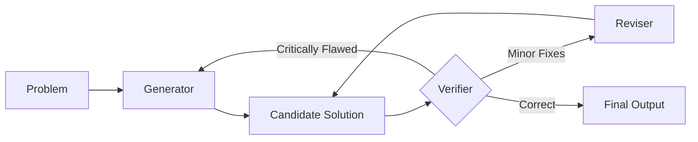

> [!IMPORTANT]
> **AI Context & Knowledge Heritage**
> - **Subsystem**: Agent Skills Registry / aletheia-reasoning
> - **Architecture**: `@docs ARCHITECTURE:Documentation`
> - **Failure Path**: Reasoning drift, unverified assumptions, or premature solution emission.
> - **Observability**: Traceability via `execution/parity_guard.py` (`[SKILL]`)

# 🧠 Aletheia Reasoning Protocol

> **Purpose**: High-fidelity reasoning framework designed to bridge the gap between simple prediction and rigorous proof by forcing the agent to act as its own adversary.
> **Workflow Binding**: Used during [`/debug`](../../workflows/debug.md), [`/refactor`](../../workflows/refactor.md), and [`/audit`](../../workflows/audit.md).

---

## 🎯 Progressive Disclosure & L3 Reference Index

Read **REQUIRED** core workflow below; consult deep **L3 Reference Guides** on demand:

| L3 Reference Guide / Tool | Purpose | Trigger / When to Load |
|---|---|---|
| [`references/nexus_v3_tadpole_engineer.md`](./references/nexus_v3_tadpole_engineer.md) | Sovereign Nexus Engineer v3.0 operational persona & distributed-systems rigor | High-risk architectural refactoring or security reviews |
| [`scripts/aletheia_linter.py`](./scripts/aletheia_linter.py) | Deterministic validator for Aletheia reasoning traces (`[GENERATOR]`, `[VERIFIER]`, `[FINAL]`) | Verifying compliance of complex reasoning logs or `--test` validation |

---

## ⚙️ The Operational Loop

The agent MUST execute these stages sequentially. **Do not skip to Final Output without a Verifier's seal of approval.**



### 1. 🏗️ Generator `[GENERATOR]`
The engine of exploration:
- **Goal**: Produce a high-probability **Candidate Solution**.
- **Focus**: Breadth, creative approach selection, and initial drafting.
- **Requirement**: Must explicitly state the assumptions made during generation.

### 2. 🛡️ Verifier `[VERIFIER]`
The internal adversary. **The Verifier must assume the solution is wrong until proven otherwise.**
- **The Rubric**:
  - **Logical Continuity**: Does step $N+1$ follow logically from step $N$?
  - **Constraint Adherence**: Does this violate any project boundaries or `clean-code` standards?
  - **Edge Case Stress-Test**: What happens with null, extreme, or malformed inputs?
  - **Parity Check**: Does this change break existing functionality? The Verifier MUST verify with `parity_guard.py` or equivalent test runner.
- **Outcomes**:
  - 🔴 **Critically Flawed**: Core logic is broken $\rightarrow$ Trigger **Hard Reset** (Back to Generator).
  - 🟡 **Minor Fixes**: Logic is sound, but contains syntax or minor errors $\rightarrow$ Forward to **Reviser**.
  - 🟢 **Correct**: Solution is hardened $\rightarrow$ Proceed to **Final Output**.

### 3. 💉 Reviser `[REVISER]`
The precision instrument:
- **Goal**: Apply targeted adjustments based on Verifier feedback.
- **Constraint**: Do not rewrite the entire solution if the core logic is sound; surgically fix the identified flaws. If the same flaw is flagged three times, trigger a Hard Reset to the Generator.
- **Loop**: Once revised, the solution **MUST** return to the `[VERIFIER]` for re-evaluation.

---

## 🛡️ Socratic Gate: Hypothesis Stress Testing

Before concluding any Aletheia cycle, confirm:
1. **At Least 2 Competing Hypotheses**: Did the generator consider an alternate path?
2. **Discriminator Probe**: Was an explicit verification command executed rather than assumed?
3. **Loop-Break Guard**: Has the generator-verifier-reviser loop iterated $\le 3$ times? (Escalate if 3 attempts fail).

---

## ⚠️ Anti-Patterns & Sovereign Remedies

| Anti-Pattern | Operational Risk | Sovereign Remedy |
|---|---|---|
| Self-Confirmation Bias | Agent agrees with its own buggy generation | Verifier adopts adversary persona with mandatory rubric |
| Infinite Revision Loop | Agent oscillates between minor fixes endlessly | 3-iteration circuit breaker escalates to Entity 0 |
| Omitting Trace Tags | Reasoning is untraceable and non-auditable | Tag all cognitive steps with `[GENERATOR]`, `[VERIFIER]`, `[FINAL]` |
| Unverified Assertions | "It should work" without executing tests | Run `parity_guard.py` or test commands before verdict |

---

## 🛠️ Verification & Execution Commands

```powershell
# Validate reasoning trace structure
python .agent/skills/aletheia-reasoning/scripts/aletheia_linter.py <trace_file.md>

# Run self-test suite
python .agent/skills/aletheia-reasoning/scripts/aletheia_linter.py --test
```
