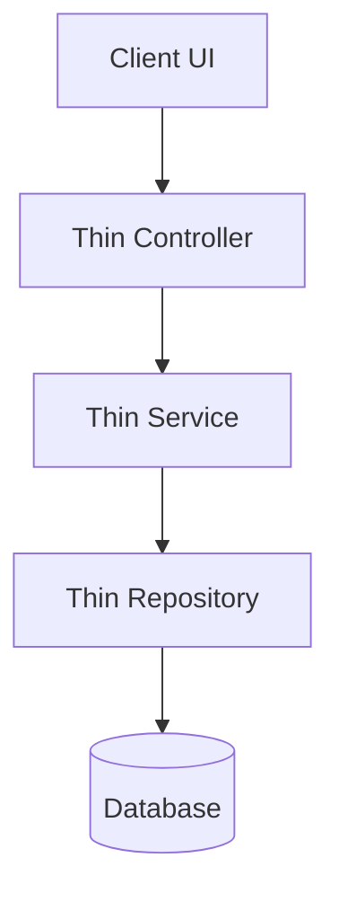
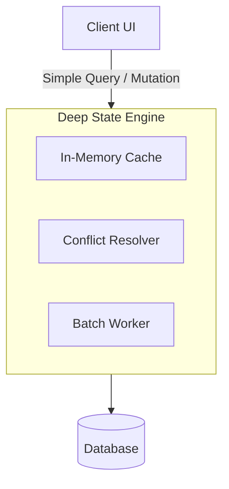

# Deep Module Design Patterns & Architectural Refactoring (L3)

> [!IMPORTANT]
> **AI Context & Knowledge Heritage**
> - **Subsystem**: Agent Skills Registry / improve-codebase-architecture / references
> - **Architecture**: `@docs ARCHITECTURE:Documentation`
> - **Failure Path**: Shallow module proliferation, scattered locality, or leaky abstraction seams.
> - **Observability**: Traceability via `execution/parity_guard.py` (`[IMPROVE_CODEBASE_ARCHITECTURE]`)

---

## 1. Deep vs. Shallow Modules (Ousterhout's Principle)

In John Ousterhout's *Philosophy of Software Design*, the most fundamental metric of software architecture is **Module Depth**: the ratio between the complexity of a module's implementation and the complexity of its interface.

```
       SHALLOW MODULE                        DEEP MODULE
┌───────────────────────────┐         ┌───────────────────────────┐
│       Wide Interface      │         │      Narrow Interface     │
│  (Many methods, options)  │         │  (Few, intuitive methods) │
├───────────────────────────┤         ├───────────────────────────┤
│    Thin Implementation    │         │                           │
│ (Little hidden complexity)│         │    Deep Implementation    │
└───────────────────────────┘         │  (Hides concurrency, I/O, │
                                      │   caching, state sync)    │
                                      │                           │
                                      └───────────────────────────┘
```

- **Deep Modules**: Provide powerful functionality behind a simple, compact interface (e.g., standard Unix file I/O: `open`, `read`, `write`, `close` hides disk layout, caching, sector allocation, and device drivers).
- **Shallow Modules**: Interface complexity approaches or exceeds implementation complexity (e.g., a 20-line class with 6 methods that each forward to another class).

---

## 2. The 7 Deep Module Vocabulary Concepts

When evaluating or discussing codebase architecture in Tadpole OS, use this standardized vocabulary:

| Concept | Definition | Architectural Goal |
|---|---|---|
| **Module** | Scale-agnostic unit with an interface and implementation (function, struct, actor, hub, store, package). | Consistent boundaries at all zoom levels. |
| **Interface** | Everything a caller must understand to use the module correctly (types, preconditions, error modes, side-effects). | Minimize cognitive load on caller. |
| **Depth** | Ratio of implementation capability to interface complexity. | Maximize depth; avoid thin pass-through wrappers. |
| **Seam** | An isolation point where behavior can be varied or substituted without modifying callers. | Provide extension points without leakage. |
| **Adapter** | A concrete implementation plugging into a seam. | Decouple platform/vendor specifics (e.g. LLM providers). |
| **Leverage** | Capability callers gain per unit of interface complexity learned. | High leverage: simple call performs substantial work safely. |
| **Locality** | Concentration of related logic, changes, bug fixes, and verification in one place. | Avoid "shotgun surgery" where 1 feature touches 8 files. |

---

## 3. Detecting Architectural Friction

### 1. High Churn Hotspots
Modules that change in almost every pull request or commit are experiencing **Scattered Locality**. Either the module is doing too much (a God object) or callers are leaking details into it.
- **Remedy**: Extract self-contained sub-domains or pull caller logic into a deep engine.

### 2. Pass-Through Classes & Wrappers
When Class A calls Class B with identical method signatures and no transformation or policy enforcement:
```typescript
// ❌ SHALLOW WRAPPER: Zero added leverage
class UserProxy {
  constructor(private client: HttpClient) {}
  getUser(id: string) { return this.client.get(`/users/${id}`); }
  deleteUser(id: string) { return this.client.delete(`/users/${id}`); }
}
```
- **Remedy**: Eliminate the proxy, or deepen it into a full User Session Manager that handles token refresh, offline caching, and optimistic UI updates.

### 3. Temporal Decomposition
Decomposing code according to the sequence of operations (Step 1, Step 2, Step 3 in separate modules) rather than by information hiding:
- **Remedy**: Group code by the shared knowledge or data structure it encapsulates, not by when it runs.

---

## 4. Blast Radius & Sovereign Graph Integration

Before refactoring any core hub in Tadpole OS (`server-rs/src/state`, `server-rs/src/routes`, Zustand stores, or database services), evaluate structural blast radius:

```powershell
# Check symbol callers and blast radius before edits
npm run graph:blast -- --path server-rs/src/routes/intelligence.rs --name get_blast_radius

# Inspect call dependencies across the file
npm run graph:file -- --path src/pages/Neural_Map.tsx
```

Audit report artifacts are maintained at:
`reports/intelligence/audit_context.json`

---

## 5. Visual Mermaid Architecture Diagrams

When proposing an architectural deepening in reports, pair a before/after diagram:

### Before (Shallow & Fragmented):


### After (Deep Engine):

