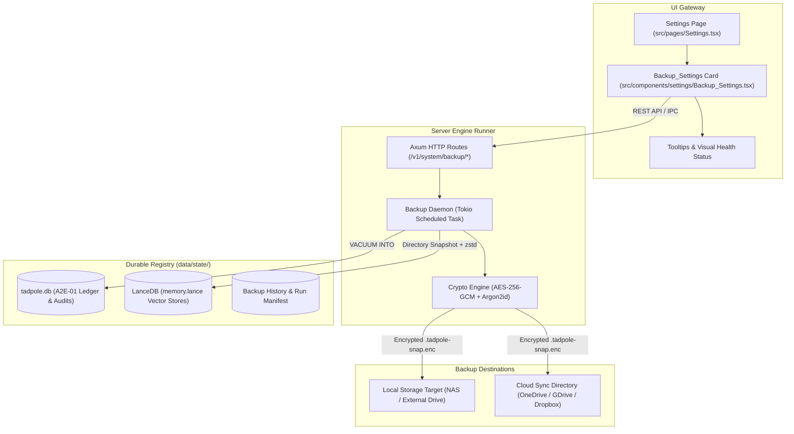

# Sovereign Blueprint: Durable State Separation & Encrypted Backup Daemon

> [!IMPORTANT]
> **AI Context & Knowledge Heritage**
> - **Subsystem**: Sovereign Engine & UI / Storage & Disaster Recovery
> - **Architecture**: `@docs ARCHITECTURE:Core`, `@docs ARCHITECTURE:State`, `@docs ARCHITECTURE:UI-Components`
> - **Failure Path**: Local disk failure, accidental `.tmp/` cleanup (`git clean -fdx`), SQLite WAL corruption, unencrypted snapshot leak in cloud sync directories.
> - **Observability**: `[BackupDaemon]`, `[Database]`, `[SnapshotRestore]`, telemetry events in `tadpole.db` and `sidecar_runtime.log`.

---

## 1. Executive Summary & Architectural Scope

This blueprint specifies the architecture, data contracts, security mechanisms, and deterministic execution sequence for **Durable State Separation and Automated Encrypted Backups** in Tadpole OS.

### Problem Vector
1. **Volatile Directory Ambiguity**: Historical documentation and bench runners refer to `.tmp/` for databases. Since `.tmp/` is defined as disposable and volatile in sovereign directives, any state written or linked there is subject to unconditional deletion.
2. **Single-Drive Point-of-Failure**: The `A2E-01` double-entry financial ledger, agent mission audit trails, and LanceDB semantic memory embeddings sit unencrypted on a single drive without automated replication or point-in-time recovery (PITR).

### Architectural Decisions (Locked via Socratic Gate)
1. **Durable Partitioning (Option A)**: Relocate all persistent state into `data/state/` (isolated from `data/cache/` and `.tmp/`).
2. **Dual-Destination Choice (Local / Cloud)**: 
   - **Local (Preferred)**: User specifies an absolute local target directory (e.g. secondary NVMe, external USB drive, or SMB/NFS NAS mount).
   - **Cloud (via Local Sync)**: User may point the target directory to a folder managed by a local cloud sync client (e.g. `C:\Users\<user>\OneDrive\TadpoleBackups`, `Google Drive`, `Dropbox`, or `iCloud Drive`). This avoids a Tadpole-specific cloud API integration, but the sync provider receives and stores the files according to its service and account configuration; it is not fully local or a blanket privacy guarantee.
3. **Zero-Knowledge AES-256 Encryption**:
   - Master key derived from a user passphrase using **Argon2id** (memory: 64MB, iterations: 3, parallelism: 4).
   - Generates an exportable `.tadpole-recovery.key` file for emergency offline disaster recovery.
4. **Hourly Active Engine Cadence & Rolling Retention**:
   - Automated snapshot daemon triggers hourly while the engine is running.
   - Enforces a rolling **48-hour retention policy** (automatically purges snapshots older than 48 hours to conserve disk space).
   - Instant **"Backup Now"** manual trigger button on the Settings screen.
5. **Settings UI Placement**:
   - Integrated as a dedicated **"Durable State & Backups"** options panel inside `src/pages/Settings.tsx` (between Governance and Architecture settings), complete with descriptive tooltips for every control.

---

## 2. The Sovereign 4-Pillar Architectural Breakdown



---

### Pillar 1: Gateway (Interface & UI Hierarchy)

#### 1. Component Hierarchy
- `src/pages/Settings.tsx`: Hosts the new `<Backup_Settings />` component.
- `src/components/settings/Backup_Settings.tsx`:
  - **Destination Toggle**: Radio group / segmented control: `Local Storage (Preferred)` vs `Cloud Sync Folder`.
  - **Path Selector**: Input field with browse button and validation for the destination path.
  - **Passphrase & Recovery Key**: Password input with strength meter, plus a button to generate/download the `.tadpole-recovery.key`.
  - **Cadence & Retention**: Configured to hourly active snapshots with 48-hour rolling retention indicator.
  - **Status Badge & Trigger**: Displays last backup timestamp, total backup size, health badge (`HEALTHY`, `SYNCING`, `DEGRADED`), and an instant `Backup Now` button with live spinner.
  - **Sovereign Tooltips**: Every input and toggle wrapped in `<Tooltip />` detailing security and privacy guarantees.

#### 2. REST API Endpoints (`server-rs/src/routes/backup.rs`)
| Method | Endpoint | Description | Request / Response |
| :--- | :--- | :--- | :--- |
| `GET` | `/v1/system/backup/status` | Current backup health, last snapshot time, destination path, and retention stats. | `200 OK -> BackupStatusResponse` |
| `POST` | `/v1/system/backup/configure` | Update backup destination mode (`local` \| `cloud_sync`), target path, and passphrase. | `Body: BackupConfigPayload -> 200 OK` |
| `POST` | `/v1/system/backup/trigger` | Manually triggers an immediate point-in-time snapshot. | `202 Accepted -> { task_id, status: "in_progress" }` |
| `POST` | `/v1/system/backup/restore` | Verifies and restores system state from a designated encrypted snapshot bundle. | `Body: RestoreRequest -> 200 OK / 400 Bad Request` |
| `GET` | `/v1/system/backup/history` | Lists available snapshot bundles in the destination directory with integrity hashes. | `200 OK -> Vec<SnapshotMetadata>` |

---

### Pillar 2: Runner (Lifecycle & Execution Logic)

#### 1. Non-Blocking SQLite WAL Snapshot
- Direct invocation of SQLite Online Backup via:
  ```sql
  VACUUM INTO 'data/state/.tmp_backup/tadpole_snapshot.db';
  ```
- **Invariant**: Running `VACUUM INTO` does not block active read/write transactions on `tadpole.db` and generates a fully checkpointed, consistent database copy.

#### 2. LanceDB Shard Compaction & Archive
- Pauses active vector write commits via lock in `VectorMemory`.
- Packages `data/state/workspaces/*/agents/*/memory.lance/` directories using multi-threaded `zstd` compression into `memory_snapshot.tar.zst`.

#### 3. Zero-Knowledge Cryptographic Packaging
- **Derivation**: User passphrase + 32-byte salt $\xrightarrow{\text{Argon2id}}$ 256-bit AES Master Key.
- **Envelope Creation**:
  - Snapshot Manifest: JSON containing timestamp, TadpoleOS version, SHA-256 hashes of database and vector files.
  - Encryption: **AES-256-GCM** (authenticated encryption with 12-byte random nonce).
  - Output Bundle: `tadpole-snapshot-{YYYYMMDD-HHMMSS}.tadpole-snap.enc`.

#### 4. Scheduled Background Daemon (`server-rs/src/services/backup_daemon.rs`)
- Background Tokio task spawned during `startup::spawn_background_tasks`.
- Executes on an hourly timer while the engine runtime is active.
- **Rolling Retention Pruning**: Scans the destination directory for matching `.tadpole-snap.enc` files, sorts by creation timestamp, and unlinks files with age $> 48$ hours.

---

### Pillar 3: Registry (Data Layout & Persistence Strategy)

#### 1. Directory Structure Standard
```text
TadpoleOS/
├── .tmp/                         # DISPOSABLE (May be wiped at any time)
│   ├── crashes/
│   ├── tool_overflow/
│   └── active_port.json
├── data/
│   ├── cache/                    # DISPOSABLE (Audio cache, TTS models, temp artifacts)
│   │   └── audio_cache.db
│   └── state/                    # CRITICAL DURABLE STATE (Target of Backup Daemon)
│       ├── tadpole.db            # Primary Relational DB (A2E-01 Ledger, Audit Trail)
│       ├── system_backup.json    # Local daemon configuration & credentials hash
│       └── workspaces/           # Agent Workspaces & LanceDB Vector Stores
│           └── {workspace_id}/
│               └── agents/
│                   └── {agent_id}/
│                       └── memory.lance/
```

#### 2. Database Schema Migration (`migrations/20261023000000_create_backups_table.sql`)
```sql
CREATE TABLE IF NOT EXISTS system_backups (
    id TEXT PRIMARY KEY,
    snapshot_filename TEXT NOT NULL,
    destination_type TEXT NOT NULL CHECK(destination_type IN ('local', 'cloud_sync')),
    destination_path TEXT NOT NULL,
    file_size_bytes INTEGER NOT NULL,
    sha256_checksum TEXT NOT NULL,
    sqlite_bytes INTEGER NOT NULL,
    lancedb_bytes INTEGER NOT NULL,
    status TEXT NOT NULL CHECK(status IN ('completed', 'failed', 'pruned')),
    error_message TEXT,
    created_at INTEGER NOT NULL,
    pruned_at INTEGER
);

CREATE INDEX IF NOT EXISTS idx_system_backups_created_at ON system_backups(created_at);
```

---

### Pillar 4: Security (Zero-Trust Guard & Integrity Verification)

1. **Zero-Knowledge Cloud Protection**: Because files are encrypted with AES-256-GCM before writing to the target directory, copying them into OneDrive, Google Drive, or Dropbox exposes zero plaintext financial records or embeddings to cloud providers.
2. **Path Traversal Guard**: All user-provided destination paths must pass canonical path sanitization via `crate::utils::security::validate_path` or host directory resolution to prevent directory traversal (`../`) vulnerabilities.
3. **Recovery Mnemonic / Key File**:
   - Generates a standalone JSON key manifest (`tadpole-recovery.key`) containing the Argon2id parameters (salt, memory, iterations) and an encrypted verification canary string.
   - Allows users to restore their twin's memory on a new machine even if the original installation was lost.
4. **Integrity Validation on Restore**:
   - Authenticated encryption (GCM tag verification) verifies that the snapshot has not suffered bit-rot or tampering before decryption begins.
   - Decrypted SQLite database passes an initial `PRAGMA integrity_check;` before state swap.

---

## 3. Deterministic Task Sequence & Implementation Plan

```mermaid
gantt
    title Durable State Separation & Backup Daemon Implementation
    dateFormat  X
    axisFormat %s
    section Stage 1: Path Migration
    Consolidate state paths to data/state/      :active, s1, 0, 15
    Update resolve_canonical_database_url      :active, s2, 15, 25
    Update workspaces_root in memory.rs        :active, s3, 25, 35
    section Stage 2: Engine Backend
    SQLite VACUUM INTO & LanceDB archiver      :s4, 35, 55
    AES-256-GCM & Argon2id crypto module       :s5, 55, 70
    Backup daemon & 48h rolling retention      :s6, 70, 85
    Axum REST routes in server-rs              :s7, 85, 100
    section Stage 3: Frontend UI
    Settings store schema update (settings_store) :s8, 100, 115
    Backup_Settings component with tooltips    :s9, 115, 135
    Integration in Settings.tsx & i18n         :s10, 135, 150
    section Stage 4: Verification
    Invariant tests (inv_010_durable_state)    :s11, 150, 170
    ADG v2 verification & parity check         :s12, 170, 185
```



### Stage 1: Directory Canonicalization & State Separation
1. Update `server-rs/src/state/init/databases.rs` to anchor default database location to `base_dir/data/state/tadpole.db`.
2. Add automatic backwards-compatible migration in `resolve_canonical_database_url`: if `data/tadpole.db` exists but `data/state/tadpole.db` does not, atomically move or copy the legacy file to `data/state/tadpole.db`.
3. Update `server-rs/src/routes/memory.rs` (`workspaces_root`) to point to `data/state/workspaces`.

### Stage 2: Backup Engine & Cryptographic Daemon (`server-rs`)
1. Implement `server-rs/src/services/backup/snapshot.rs`:
   - Non-blocking `VACUUM INTO` routine for SQLite.
   - LanceDB file directory archiver using `flate2` or `zstd`.
2. Implement `server-rs/src/services/backup/crypto.rs`:
   - Argon2id key derivation and AES-256-GCM envelope encryptor/decryptor.
3. Implement `server-rs/src/services/backup/daemon.rs`:
   - Hourly Tokio interval runner.
   - 48-hour pruning routine scanning target directory.
4. Add Axum endpoints under `server-rs/src/routes/backup.rs` and bind to application state.

### Stage 3: Settings UI Options Panel & Tooltips
1. Update `src/stores/settings_store.ts`:
   - Add backup configuration fields (`backup_enabled`, `backup_mode: 'local' | 'cloud_sync'`, `backup_path: string`, `backup_last_run: number`).
2. Create `src/components/settings/Backup_Settings.tsx`:
   - Render destination choice (Local vs Cloud Sync).
   - Add path picker / input, passphrase input with visibility toggle, and "Download Recovery Key" action.
   - Render live backup health card (Last Backup, Size, Retention: 48h, Next Run).
   - Render manual "Backup Now" button with immediate progress indicator.
   - Wrap each control with `<Tooltip content={...} position="top" />` adhering to sovereign UI conventions.
3. Update `src/locales/en/settings.json` with all tooltip text and descriptive labels.

### Stage 4: Verification & Active Documentation Guard (ADG v2)
1. Write invariant test `tests/invariants/inv_010_durable_state_backups.test.ts`:
   - Asserts `tadpole.db` lives under `data/state/` and never in `.tmp/`.
   - Asserts encrypted snapshot files contain valid GCM headers and cannot be decrypted without the correct key.
2. Run `npm run adg:generate` to register new witness tests into `adg.manifest.json`.
3. Run `npm run adg:verify` and `npx vitest run tests/invariants/` to ensure zero drift.

---

## 4. Agent Execution Map

| Stage / Component | Lead Specialist Agent | Supporting Skills | Verification Artefact |
| :--- | :--- | :--- | :--- |
| **Stage 1: Paths & Migrations** | `systems-architect` | `database-design`, `clean-code` | `tests/db_tests.rs` |
| **Stage 2: Engine & Crypto** | `rust-pro` | `rust-pro`, `security-auditor` | `server-rs/tests/backup_test.rs` |
| **Stage 3: Settings UI & Tooltips** | `frontend-designer` | `frontend-design`, `web-design-guidelines` | `src/pages/Settings.test.tsx` |
| **Stage 4: Invariants & ADG** | `principal-qa` | `adg-governance`, `testing-patterns` | `tests/invariants/inv_010_*.test.ts` |

---

## 5. Definition of Done & Verification Gate

1. **Parity Guard Verification**:
   - Run `python execution/parity_guard.py` to confirm zero documentation or architectural drift.
2. **Active Documentation Guard (ADG v2)**:
   - Run `npm run adg:verify` to guarantee machine-maintained test witness linkage.
3. **Execution Test**:
   - Triggering manual "Backup Now" creates an encrypted `.tadpole-snap.enc` file in the configured directory.
   - Verified that unlinking `.tmp/` leaves the digital twin memory and ledger 100% intact.
