# Sovereign Blueprint: Durable State Separation & Encrypted Backup Daemon

> [!IMPORTANT]
> **AI Context & Knowledge Heritage**
> - **Subsystem**: Sovereign Engine & UI / Storage & Disaster Recovery
> - **Architecture**: `@docs ARCHITECTURE:Core`, `@docs ARCHITECTURE:State`, `@docs ARCHITECTURE:UI-Components`
> - **Failure Path**: Local disk failure, accidental `.tmp/` cleanup (`git clean -fdx`), SQLite WAL corruption, unencrypted snapshot leak in cloud sync directories.
> - **Observability**: `[BackupDaemon]`, `[Database]`, `[SnapshotRestore]`, telemetry events in `tadpole.db` and `sidecar_runtime.log`.

---

## 1. Executive Summary & Architectural Scope

This blueprint specifies the architecture, data contracts, security mechanisms, and deterministic execution sequence for **Durable State Separation and Automated Encrypted Backups** in Tadpole OS.

### Problem Vector
1. **Volatile Directory Ambiguity**: Historical documentation and bench runners refer to `.tmp/` for databases. Since `.tmp/` is defined as disposable and volatile in sovereign directives, any state written or linked there is subject to unconditional deletion.
2. **Single-Drive Point-of-Failure**: The `A2E-01` double-entry financial ledger, agent mission audit trails, and LanceDB semantic memory embeddings sit unencrypted on a single drive without automated replication or point-in-time recovery (PITR).

### Architectural Decisions (Implemented & Verified)
1. **Durable Partitioning (Option A)**: Relocate all persistent state into `data/state/` (isolated from `data/cache/` and `.tmp/`).
2. **Dual-Destination Choice (Local / Cloud) with Path Confinement**:
   - **Authorized Roots**: Snapshot paths are strictly confined to `backups/` (default), `data/backups/`, or an explicit operator-configured `TADPOLE_BACKUP_ROOT` (arbitrary host paths are rejected with `403 Forbidden`).
   - **Cloud (via Local Sync)**: Operators who wish to replicate into a local sync folder (e.g. OneDrive, Google Drive, Dropbox) explicitly set `TADPOLE_BACKUP_ROOT` to that sync root. Cloud sync providers only ever receive encrypted ciphertext.
3. **Zero-Knowledge Authenticated Encryption (`TADPOLE_SNAP_V2`)**:
   - Master encryption & MAC keys derived from a ≥12-character user passphrase using **RFC 2898 PBKDF2-HMAC-SHA512 (210,000 rounds)** (`TADPOLE_SNAP_V1` 100,000 rounds retained strictly for backward-compatible decryption).
   - Authenticated **ChaCha20 + RFC 2104 HMAC-SHA256 (Encrypt-then-MAC)** envelope; writes a `.tadpole-recovery.key` manifest (version `2.0`) alongside snapshots and allows downloading `tadpole-recovery-notes.json` from Settings.
   - Passphrase is **never serialized** to `system_backup.json` (`skip_serializing`; held only in `Zeroizing<String>` memory or `TADPOLE_BACKUP_PASSPHRASE`).
4. **Hourly Active Engine Cadence & Rolling Retention**:
   - Automated snapshot daemon triggers hourly while the engine is running.
   - Enforces a rolling **48-hour retention policy** (automatically purges snapshots older than 48 hours and updates `system_backups.status = 'pruned'`).
   - Instant **"Backup Now"** manual trigger button on the Settings screen.
5. **Settings UI & RBAC Placement**:
   - Integrated as a dedicated **"Durable State & Backups"** panel inside `src/pages/Settings.tsx` (`src/components/settings/Backup_Settings.tsx`). All 5 `/v1/system/backup/*` endpoints enforce **`RequireAdmin`** (`NEURAL_ADMIN_TOKEN` / browser Step-Up Administrative Token).

---

## 2. The Sovereign 4-Pillar Architectural Breakdown

```mermaid
graph TD
    subgraph "UI Gateway"
        SP["Settings Page (src/pages/Settings.tsx)"]
        BS["Backup_Settings Card (src/components/settings/Backup_Settings.tsx)"]
        TT["Tooltips & Visual Health Status"]
    end

    subgraph "Server Engine Runner"
        API["Axum HTTP Routes (/v1/system/backup/*)"]
        BD["Backup Daemon (Tokio Scheduled Task)"]
        ENC["Crypto Engine (ChaCha20 + HMAC-SHA256 + PBKDF2-SHA512 210k)"]
    end

    subgraph "Durable Registry (data/state/)"
        DB[("tadpole.db (A2E-01 Ledger & Audits)")]
        LANCE[("Workspaces & LanceDB Vector Stores")]
        META[("Backup History & Run Manifest")]
    end

    subgraph "Backup Destinations"
        LOC["Local Storage Target (backups/ or TADPOLE_BACKUP_ROOT)"]
        SYNC["Cloud Sync Directory (via TADPOLE_BACKUP_ROOT)"]
    end

    SP --> BS
    BS --> TT
    BS -->|REST API (RequireAdmin)| API
    API --> BD
    BD -->|VACUUM INTO| DB
    BD -->|TADPOLE_ARCH_V1 Pack| LANCE
    BD --> ENC
    ENC -->|Encrypted .tadpole-snap.enc| LOC
    ENC -->|Encrypted .tadpole-snap.enc| SYNC
```

---

### Pillar 1: Gateway (Interface & UI Hierarchy)

#### 1. Component Hierarchy
- `src/pages/Settings.tsx`: Hosts the new `<Backup_Settings />` component.
- `src/components/settings/Backup_Settings.tsx`:
  - **Destination Toggle**: Radio group / segmented control: `Local Storage (Preferred)` vs `Cloud Sync Folder`.
  - **Path Selector**: Input field with browse button and validation for the destination path.
  - **Passphrase & Recovery Key**: Password input with strength meter, plus a button to generate/download the `.tadpole-recovery.key`.
  - **Cadence & Retention**: Configured to hourly active snapshots with 48-hour rolling retention indicator.
  - **Status Badge & Trigger**: Displays last backup timestamp, total backup size, health badge (`HEALTHY`, `SYNCING`, `DEGRADED`), and an instant `Backup Now` button with live spinner.
  - **Sovereign Tooltips**: Every input and toggle wrapped in `<Tooltip />` detailing security and privacy guarantees.

#### 2. REST API Endpoints (`server-rs/src/routes/backup.rs` — All `RequireAdmin`)
| Method | Endpoint | Description | Request / Response |
| :--- | :--- | :--- | :--- |
| `GET` | `/v1/system/backup/status` | Current backup health, last snapshot time, confined destination path, and retention stats. | `200 OK -> BackupStatusResponse` |
| `POST` | `/v1/system/backup/configure` | Update backup destination mode (`local` \| `cloud_sync`), confined target path, and in-memory passphrase. | `Body: BackupConfigPayload -> 200 OK` |
| `POST` | `/v1/system/backup/trigger` | Synchronously executes an immediate point-in-time `TADPOLE_SNAP_V2` snapshot. | `200 OK -> { success, backup_id, snapshot_filename, file_size_bytes, sqlite_bytes, lancedb_bytes, sha256, created_at }` |
| `POST` | `/v1/system/backup/restore` | Decrypts and verifies snapshot integrity (`PRAGMA integrity_check`). Defaults to verify-only dry-run (`apply: false`); `apply: true` stages `data/state/tadpole.db.restored` + `workspaces.restored` for next restart promotion. | `Body: { snapshot_filename, passphrase?, apply? } -> 200 OK / 400 / 403` |
| `GET` | `/v1/system/backup/history` | Lists available snapshot bundles in the `system_backups` audit ledger with integrity hashes. | `200 OK -> Vec<BackupHistoryRecord>` |

---

### Pillar 2: Runner (Lifecycle & Execution Logic)

#### 1. Non-Blocking SQLite WAL Snapshot
- Direct invocation of SQLite Online Backup via:
  ```sql
  VACUUM INTO 'data/state/.tmp_backup/tadpole_snapshot.db';
  ```
- **Invariant**: Running `VACUUM INTO` does not block active read/write transactions on `tadpole.db` and generates a fully checkpointed, consistent database copy.

#### 2. Workspace & LanceDB Archive (`server-rs/src/services/backup/snapshot.rs`)
- Walks `data/state/workspaces/` (falling back to `data/workspaces/`) skipping symlinks with depth bounded ($\le 32$), packing `tadpole.db` and regular workspace files into a deterministic, symlink-safe, overflow-checked `TADPOLE_ARCH_V1\0` binary archive.

#### 3. Zero-Knowledge Cryptographic Packaging (`server-rs/src/services/backup/crypto.rs`)
- **Derivation**: ≥12-char user passphrase + 32-byte salt $\xrightarrow{\text{PBKDF2-HMAC-SHA512 (210,000 rounds)}}$ 64-byte key material (32-byte ChaCha20 encryption key + 32-byte HMAC-SHA256 authentication key).
- **Envelope Creation**:
  - Header Magic: `TADPOLE_SNAP_V2\0` (`TADPOLE_SNAP_V1\0` at 100,000 rounds remains supported for legacy decryption).
  - Encryption: **ChaCha20 + RFC 2104 HMAC-SHA256 (Encrypt-then-MAC)** with constant-time tag verification.
  - Output Bundle: `tadpole-snapshot-{YYYYMMDD-HHMMSS}.tadpole-snap.enc`.

#### 4. Scheduled Background Daemon (`server-rs/src/services/backup/daemon.rs`)
- Background Tokio task spawned during `startup::spawn_background_tasks`.
- Executes on an hourly timer while the engine runtime is active.
- **Rolling Retention Pruning**: Scans the destination directory for matching `.tadpole-snap.enc` files, deletes files with age $> 48$ hours, and marks `system_backups.status = 'pruned'`.

---

### Pillar 3: Registry (Data Layout & Persistence Strategy)

#### 1. Directory Structure Standard
```text
TadpoleOS/
├── .tmp/                         # DISPOSABLE (May be wiped at any time)
│   ├── crashes/
│   ├── tool_overflow/
│   └── active_port.json
├── data/
│   ├── cache/                    # DISPOSABLE (Audio cache, TTS models, temp artifacts)
│   │   └── audio_cache.db
│   └── state/                    # CRITICAL DURABLE STATE (Target of Backup Daemon)
│       ├── tadpole.db            # Primary Relational DB (A2E-01 Ledger, Audit Trail)
│       ├── system_backup.json    # Local daemon configuration (passphrase is NEVER persisted)
│       └── workspaces/           # Agent Workspaces & LanceDB Vector Stores
│           └── {workspace_id}/
│               └── agents/
│                   └── {agent_id}/
│                       └── memory.lance/
```

#### 2. Database Schema Migration (`migrations/20261023000000_create_backups_table.sql`)
```sql
CREATE TABLE IF NOT EXISTS system_backups (
    id TEXT PRIMARY KEY,
    snapshot_filename TEXT NOT NULL,
    destination_type TEXT NOT NULL CHECK(destination_type IN ('local', 'cloud_sync')),
    destination_path TEXT NOT NULL,
    file_size_bytes INTEGER NOT NULL,
    sha256_checksum TEXT NOT NULL,
    sqlite_bytes INTEGER NOT NULL,
    lancedb_bytes INTEGER NOT NULL,
    status TEXT NOT NULL CHECK(status IN ('completed', 'failed', 'pruned')),
    error_message TEXT,
    created_at INTEGER NOT NULL,
    pruned_at INTEGER
);

CREATE INDEX IF NOT EXISTS idx_system_backups_created_at ON system_backups(created_at);
```

---

### Pillar 4: Security (Zero-Trust Guard & Integrity Verification)

1. **Zero-Knowledge Cloud Protection**: Because files are encrypted with `TADPOLE_SNAP_V2` (ChaCha20 + HMAC-SHA256, 210k PBKDF2-HMAC-SHA512) before writing to the target directory, syncing ciphertext into OneDrive, Google Drive, or Dropbox (via `TADPOLE_BACKUP_ROOT`) exposes zero plaintext financial records or embeddings.
2. **Path Confinement & Traversal Guard**: All destination paths are validated against authorized roots (`backups/`, `data/backups/`, or `TADPOLE_BACKUP_ROOT`), preventing directory traversal (`../`) and arbitrary host writes.
3. **Recovery Key Manifest**:
   - Writes `.tadpole-recovery.key` (`version: "2.0"`) containing the PBKDF2-HMAC-SHA512 parameters (`rounds: 210000`, `salt_hex`) and an encrypted verification canary; UI exports `tadpole-recovery-notes.json` metadata.
4. **Integrity Validation on Restore**:
   - Constant-time HMAC-SHA256 tag verification validates ciphertext authenticity before decryption begins.
   - Decrypted SQLite database passes `PRAGMA integrity_check;` before staging `tadpole.db.restored` + `workspaces.restored` for rollback-safe promotion on next boot (`server-rs/src/state/init/databases.rs`).

---

## 3. Deterministic Task Sequence & Implementation Plan

```mermaid
gantt
    title Durable State Separation & Backup Daemon Implementation
    dateFormat  X
    axisFormat %s
    section Stage 1: Path Migration
    Consolidate state paths to data/state/      :active, s1, 0, 15
    Update resolve_canonical_database_url      :active, s2, 15, 25
    Update workspaces_root in memory.rs        :active, s3, 25, 35
    section Stage 2: Engine Backend
    SQLite VACUUM INTO & LanceDB archiver      :s4, 35, 55
    ChaCha20 + HMAC-SHA256 & PBKDF2-SHA512     :s5, 55, 70
    Backup daemon & 48h rolling retention      :s6, 70, 85
    Axum REST routes in server-rs              :s7, 85, 100
    section Stage 3: Frontend UI
    Settings store schema update (settings_store) :s8, 100, 115
    Backup_Settings component with tooltips    :s9, 115, 135
    Integration in Settings.tsx                :s10, 135, 150
    section Stage 4: Verification
    Invariant tests (inv_012_durable_state)    :s11, 150, 170
    ADG v2 verification & parity check         :s12, 170, 185
```



### Stage 1: Directory Canonicalization & State Separation
1. Update `server-rs/src/state/init/databases.rs` to anchor default database location to `base_dir/data/state/tadpole.db`.
2. Add automatic backwards-compatible migration in `resolve_canonical_database_url`: if `data/tadpole.db` exists but `data/state/tadpole.db` does not, atomically copy the legacy file to `data/state/tadpole.db`.
3. Update `server-rs/src/routes/memory.rs` (`workspaces_root`) to prefer `data/state/workspaces` with fallback to `data/workspaces`.

### Stage 2: Backup Engine & Cryptographic Daemon (`server-rs`)
1. Implement `server-rs/src/services/backup/snapshot.rs`:
   - Non-blocking `VACUUM INTO` routine for SQLite and symlink-safe `TADPOLE_ARCH_V1` workspace archiver.
2. Implement `server-rs/src/services/backup/crypto.rs`:
   - PBKDF2-HMAC-SHA512 (210,000 rounds) key derivation and `TADPOLE_SNAP_V2` ChaCha20 + HMAC-SHA256 encryptor/decryptor (with legacy V1 100k decrypt compatibility).
3. Implement `server-rs/src/services/backup/daemon.rs`:
   - Hourly Tokio interval runner, authorized-root confinement, and 48-hour pruning routine.
4. Add `RequireAdmin`-protected Axum endpoints under `server-rs/src/routes/backup.rs`.

### Stage 3: Settings UI Options Panel & Tooltips
1. Update `src/stores/settings_store.ts` with backup configuration fields and in-memory-only `tadpole_os_admin_key`.
2. Create `src/components/settings/Backup_Settings.tsx` with destination selector, confined path input, passphrase field, recovery notes export (`tadpole-recovery-notes.json`), and manual "Backup Now" trigger.

### Stage 4: Verification & Active Documentation Guard (ADG v2)
1. Write invariant test `tests/invariants/inv_012_durable_state_backups.test.ts` and inline Rust unit tests in `server-rs/src/services/backup/` & `server-rs/src/routes/backup.rs`.
2. Run `npm run adg:generate`, `npm run adg:verify`, and `npx vitest run tests/invariants/` to ensure zero drift.

---

## 4. Agent Execution Map

| Stage / Component | Lead Specialist Agent | Supporting Skills | Verification Artefact |
| :--- | :--- | :--- | :--- |
| **Stage 1: Paths & Migrations** | `systems-architect` | `database-design`, `clean-code` | `server-rs/src/db_tests.rs` |
| **Stage 2: Engine & Crypto** | `rust-pro` | `rust-pro`, `security-auditor` | `server-rs/src/services/backup/` & `routes/backup.rs` tests |
| **Stage 3: Settings UI & Tooltips** | `frontend-designer` | `frontend-design`, `web-design-guidelines` | `src/components/settings/Backup_Settings.test.tsx` & `src/pages/Settings.test.tsx` |
| **Stage 4: Invariants & ADG** | `principal-qa` | `adg-governance`, `testing-patterns` | `tests/invariants/inv_012_durable_state_backups.test.ts` |

---

## 5. Definition of Done & Verification Gate

1. **Parity Guard Verification**:
   - Run `python execution/parity_guard.py` to confirm zero documentation or architectural drift.
2. **Active Documentation Guard (ADG v2)**:
   - Run `npm run adg:verify` to guarantee machine-maintained test witness linkage.
3. **Execution Test**:
   - Triggering manual "Backup Now" creates an encrypted `.tadpole-snap.enc` file in the configured directory.
   - Verified that unlinking `.tmp/` leaves the digital twin memory and ledger 100% intact.
