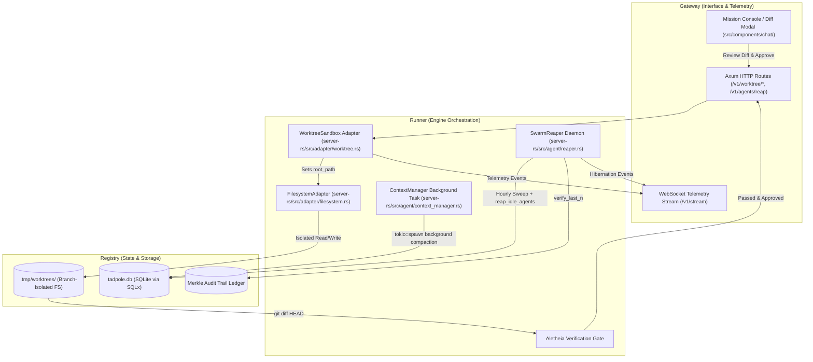
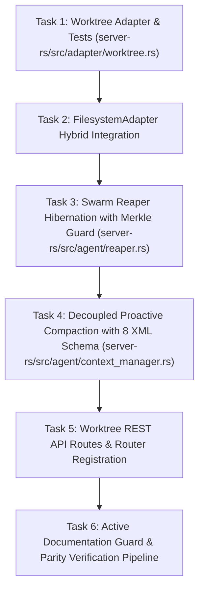

# Sovereign Blueprint: Infinity-Inspired Engine Improvements

> [!IMPORTANT]
> **AI Context & Knowledge Heritage**
> - **Subsystem**: Sovereign Engine & Infrastructure / Sandboxing & Actor Lifecycle
> - **Architecture**: `@docs ARCHITECTURE:Core`, `@docs ARCHITECTURE:Agent`, `@docs ARCHITECTURE:Infrastructure:Sandboxing`
> - **Failure Path**: Filesystem write collisions during parallel agent execution, Tokio scheduler starvation from zombie idle actors, turn-loop latency spikes from blocking LLM summarization, or uninspected mutations bypassing verification gates.
> - **Observability**: `[worktree]`, `[reaper]`, `[context_manager]`, telemetry events in tracing logs and SQLite audit tables.

---

## 1. Executive Summary & Architectural Scope

This blueprint specifies the architectural design, security boundaries, and deterministic execution sequence for integrating three high-leverage architectural patterns inspired by **`hydro-project/infinity`** into **Tadpole OS**:
1. **VCS-Native Worktree Sandboxing** (`server-rs/src/adapter/worktree.rs`)
2. **Actor Idle Reaping & Hibernation** (`server-rs/src/agent/reaper.rs`)
3. **Decoupled Background Context Compaction** (`server-rs/src/agent/context_manager.rs`)

### Problem Vector
1. **Host Filesystem Collision Risk**: Currently, `FilesystemAdapter` performs unisolated writes directly against the host workspace. If concurrent subagents modify the codebase or an LLM hallucinates corrupt syntax, the developer's working directory becomes dirty or broken, preventing clean rollbacks.
2. **Idle Tokio Actor Overhead**: Spawned swarm agents remain resident as active Tokio tasks with open `mpsc` channels and memory allocations even when inactive for hours, degrading edge/desktop performance.
3. **Turn-Loop Latency Spikes**: Context window compaction and semantic summarization currently execute synchronously within the active turn loop, stalling user interactions for 5–15 seconds during token saturation.

### Architectural Decisions (Locked via Socratic Gate)
1. **Worktree Merge & Approval Protocol (Verification Gate Preview)**:
   - Modifications inside `.tmp/worktrees/<task_id>` never auto-commit or auto-merge into `HEAD`.
   - The engine generates a clean `git diff` and surfaces an interactive preview requiring explicit operator confirmation or an Aletheia Zero-Trust verification pass before merging.
2. **Actor Idle Hibernation Policy (300s Inactivity Window)**:
   - Worker agents inactive for $> 300\text{ seconds}$ without token consumption transition to `suspended` in `tadpole.db`.
   - Primary supervisory agents (`1`, `2`, `alpha`, `general`) are strictly exempt.
   - **Crucial Security Invariant**: The existing periodic Merkle Audit Ledger integrity verification (`state.security.audit_trail.verify_last_n`) in `reaper.rs` is strictly preserved and must never be removed or bypassed.
3. **Background Compaction Scheduling (Proactive 70% Trigger)**:
   - Tier 1 heuristic compaction and Tier 2 semantic summarization run asynchronously on a background Tokio thread (`tokio::spawn`), returning a `JoinHandle`.
   - Proactive trigger fires at 70% context token saturation so condensed context is pre-computed before the active turn encounters an overflow boundary.
   - **Context Integrity Invariant**: The prompt must retain Tadpole's 8 structured XML sections (`<primary_intent>`, `<key_concepts>`, `<files_and_code>`, `<errors_and_fixes>`, `<problem_solving>`, `<all_user_messages>`, `<pending_tasks>`, `<current_work_and_next_step>`) along with `FROZEN_CONTINUATION_NOTICE`.
4. **Filesystem Adapter Integration (Hybrid Architecture)**:
   - `WorktreeSandbox` wraps and parametrizes `FilesystemAdapter` by repointing its `root_path` to the sandbox directory, ensuring all `SEC-03` path traversal, symlink resolution, and canonicalization checks remain 100% active inside the worktree.

---

## 2. The Sovereign 4-Pillar Architectural Breakdown



---

### Pillar 1: Gateway (Interface & API Hierarchy)

#### 1. REST Endpoints (`server-rs/src/routes/worktree.rs` & `server-rs/src/routes/agents.rs`)
| Method | Endpoint | Description | Request / Response |
| :--- | :--- | :--- | :--- |
| `POST` | `/v1/worktree/create` | Spawns an isolated worktree under `.tmp/worktrees/<task_id>`. | `Body: { task_id, base_ref } -> 201 Created { worktree_path, branch }` |
| `GET` | `/v1/worktree/{task_id}/diff` | Retrieves unified git diff of unmerged modifications in sandbox. | `200 OK -> { task_id, diff: string, files_changed: string[] }` |
| `POST` | `/v1/worktree/{task_id}/apply` | Merges worktree branch into active branch after verification. | `Body: { commit_message } -> 200 OK { merged_commit: string }` |
| `DELETE` | `/v1/worktree/{task_id}` | Aborts mission and force-cleans worktree and branch. | `200 OK -> { status: "cleaned" }` |
| `POST` | `/v1/agents/reap` | Manually triggers idle actor hibernation sweep. | `200 OK -> { suspended_count: number }` |

#### 2. WebSocket Telemetry Events
- `worktree:created`: Emitted when an isolated sandbox is provisioned with branch name.
- `worktree:diff_ready`: Emitted when mission files are ready for Aletheia review.
- `agent:hibernated`: Emitted when an idle actor task is aborted and persisted to SQLite.
- `context:compaction_started` & `context:compaction_completed`: Emitted off-thread to notify UI without blocking turns.

#### 3. UI Component Hierarchy
- `src/components/chat/Worktree_Diff_Modal.tsx`: Visual modal displaying side-by-side diffs, verification status, and an explicit **"Apply Changes to Main"** button.
- `src/components/agents/Agent_Card.tsx`: Displays a subtle `Sleeping (Hibernated)` badge for suspended agents, refreshing to `Active` on interaction.

---

### Pillar 2: Runner (Lifecycle & Execution Logic)

#### 1. Worktree Lifecycle State Machine
```mermaid
stateDiagram-v2
    [*] --> Initialized: Mission Assigned
    Initialized --> SandboxCreated: WorktreeSandbox::create(task_id)
    SandboxCreated --> AgentExecuting: FilesystemAdapter repointed to .tmp/worktrees/<task_id>
    AgentExecuting --> VerificationReady: Agent marks task complete
    VerificationReady --> AletheiaGate: WorktreeSandbox::diff()
    AletheiaGate --> OperatorReview: Diff inspected & tests pass
    OperatorReview --> Merged: Operator Approves -> git merge --ff-only
    OperatorReview --> Discarded: Operator Rejects -> WorktreeSandbox::cleanup()
    AletheiaGate --> Discarded: Verification Fails -> WorktreeSandbox::cleanup()
    Merged --> Cleanup: Remove worktree & delete temp branch
    Discarded --> Cleanup
    Cleanup --> [*]
```

#### 2. Swarm Reaper Hibernation Sweep Logic
- Every 3600 seconds (or on manual trigger):
  1. **Sliding-Window Checkpoint Pruning**: Prune `mission_checkpoints` for terminal missions, retaining only the latest 3 turn checkpoints per mission.
  2. **Actor Hibernation (`reap_idle_agents`)**:
     - Query `agents` table: `status = 'idle'`, `tokens_used = 0` (or inactive $>300\text{s}$), `id NOT IN ('1', '2', 'alpha', 'general')`.
     - Update status to `'suspended'`.
     - In-memory registry: Signal actor cancellation token, drop Tokio task handle, and flush memory buffers.
  3. **Stale Mission Record Deletion**: Cascade-delete records older than 48 hours (unless `is_pinned = 1`).
  4. **Stale Mission Pointer Scrubber**: Clear `active_mission` pointers in live agent registry.
  5. **Physical Workspace Purge**: Delete directories under `data/workspaces/{cluster}/missions/{mission_id}`.
  6. **Sovereign Security Invariant**: Verify Merkle Audit Ledger integrity via `state.security.audit_trail.verify_last_n(250, None)`.

#### 3. Proactive Background Context Compaction Logic
- When conversation token count crosses $0.70 \times \text{max\_tokens}$:
  1. Snapshot current conversation history.
  2. Spawn background Tokio task: `ContextManager::spawn_background_compaction(runner, ctx, history)`.
  3. Active turn continues without blocking.
  4. Once background task returns:
     - Verify 8 XML sections exist.
     - Append `FROZEN_CONTINUATION_NOTICE`.
     - Atomically swap condensed history into active mission state.

---

### Pillar 3: Registry (Data & Schema Contracts)

#### 1. SQLite Schema Invariants (`tadpole.db`)
- `agents` Table Status Enum Extension:
  - Valid statuses: `'idle'`, `'running'`, `'error'`, `'suspended'` (New), `'terminated'`.
- `mission_checkpoints` Retention Optimization:
  - Add partial index: `CREATE INDEX IF NOT EXISTS idx_mission_checkpoints_pruning ON mission_checkpoints(mission_id, turn_index DESC);`

#### 2. Filesystem Layout Contracts
```text
.tmp/
└── worktrees/
    ├── <task_id_1>/          # Isolated git worktree checkout on branch agent-worktree-<task_id_1>
    │   ├── server-rs/
    │   ├── src/
    │   └── package.json
    └── <task_id_2>/          # Concurrent isolated sandbox for second worker
```
- Strict validation: `<task_id>` must be regex `^[a-zA-Z0-9_-]+$`.
- Enforce that `.tmp/worktrees` is ignored in root `.gitignore`.

---

### Pillar 4: Security (Guard & Invariants)

#### 1. Zero Trust & Anti-Traversal Defenses (SEC-03 Compliance)
- **Task ID Whitelisting**: Reject any `task_id` with non-alphanumeric characters (excluding `-` and `_`) to prevent shell injection (`;&|`), argument injection (`--upload-pack`), or path traversal (`../`).
- **Subpath Resolution Guard**: `WorktreeSandbox::get_path` rejects paths containing `..` or leading slashes.
- **Hybrid Sandbox Boundary**: All file operations pass through `FilesystemAdapter` initialized with `root_path = sandbox.worktree_path`, ensuring symlink escapes are caught before any disk write.

#### 2. Windows File Lock Resilience
- Implement retry logic with backoff for `git worktree remove --force`:
  - If a file lock is held by a compiler or LSP daemon, retry 3 times with 500ms delay.
  - Fall back to scheduling directory removal on system reboot or marking `.tmp/worktrees/<task_id>` for deferred reaping.

---

## 3. Deterministic Task Sequence (Order of Operations)



### Phase 1: Infrastructure Sandboxing
- **Task 1.1**: Author `server-rs/src/adapter/worktree.rs` defining `WorktreeSandbox` with:
  - `create(repo_root: &Path, task_id: &str) -> Result<Self, AppError>`
  - `diff(&self) -> Result<String, AppError>`
  - `get_path(&self, relative_path: &str) -> Result<PathBuf, AppError>`
  - `cleanup(self) -> Result<(), AppError>`
- **Task 1.2**: Register `pub mod worktree;` in `server-rs/src/adapter/mod.rs`.
- **Task 1.3**: Implement the 3-path unit test suite in `worktree.rs`:
  - Path 1 (Happy Path): File mutation in sandbox, main repo untouched, diff verified.
  - Path 2 (Failure Path): Rejection of path traversal (`../escape`) and shell metacharacters (`task;rm -rf /`).
  - Path 3 (Edge Case Path): Subpath traversal boundary rejection and Windows backslash normalization.

### Phase 2: Actor Lifecycle & Resource Reclamation
- **Task 2.1**: Implement `reap_idle_agents(pool: &SqlitePool, idle_threshold_seconds: i64) -> Result<u64, AppError>` in `server-rs/src/agent/reaper.rs`.
- **Task 2.2**: Integrate `reap_idle_agents` into `SwarmReaper::sweep`.
- **Task 2.3**: Add sliding-window checkpoint pruning for terminal missions.
- **Task 2.4**: Preserve the periodic Merkle Audit Ledger verification in `SwarmReaper::start`.

### Phase 3: Context Compaction Decoupling
- **Task 3.1**: Add `spawn_background_compaction` in `server-rs/src/agent/context_manager.rs`.
- **Task 3.2**: Preserve the 8-XML-section prompt structure and `FROZEN_CONTINUATION_NOTICE`.
- **Task 3.3**: Configure proactive background trigger at 70% token limit.

### Phase 4: API & Verification Gates
- **Task 4.1**: Create `server-rs/src/routes/worktree.rs` and register routes in `server-rs/src/routes/mod.rs`.
- **Task 4.2**: Run `cargo test --bin server-rs` to ensure all unit tests pass.
- **Task 4.3**: Run `npm run test:invariants` (11/11 test files, 100% green).
- **Task 4.4**: Run `python execution/verify_ai_context.py` and `python execution/parity_guard.py`.

---

## 4. Agent Map

| Task Domain | Specialized Agent / Skill | Responsibilities |
| :--- | :--- | :--- |
| **Sandboxing & Git Adapters** | `rust-pro` + `tauri-pro` | Implementation of `WorktreeSandbox`, Windows path handling, and Git CLI wrappers. |
| **Actor Supervision & Reaper** | `rust-pro` + `architecture` | Tokio task lifecycle, SQLite hibernation queries, and Merkle audit ledger continuity. |
| **Context Compaction Engine** | `context-compression` + `clean-code` | Non-blocking token calculations, 8-XML structured summarization, and continuation notices. |
| **Security & Path Defense** | `vulnerability-scanner` + `zero-trust` | SEC-03 path canonicalization, shell injection whitelisting, and permission scoping. |
| **Verification & Compliance** | `adg-governance` + `lint-and-validate` | Parity guard synchronization, witness test manifest generation, and invariant test execution. |

---

## 5. Verification & Definition of Done

### 1. Pre-Commit Verification Pipeline
1. **Compilation & Unit Tests**:
   ```powershell
   cargo test --manifest-path server-rs/Cargo.toml adapter::worktree
   ```
2. **Invariant Test Suite**:
   ```powershell
   npm run test:invariants
   ```
3. **AI Context Alignment**:
   ```powershell
   python execution/verify_ai_context.py
   ```
4. **Tadpole OS Parity Guard**:
   ```powershell
   python execution/parity_guard.py
   ```

### 2. Machine-Maintained Documentation Guard (ADG v2)
- All new source files must include valid `@docs` links and standard AI Context Alignment headers.
- **Anti-Pattern Prevention**: Zero handwritten `Witness Tests:` or `Invariants:` headers in source files. All witness relationships must be derived via `npm run adg:generate`.

