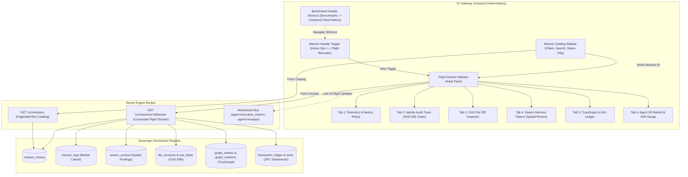

# Sovereign Blueprint: Mission Flight Recorder & Run History Dossier

> [!IMPORTANT]
> **AI Context & Knowledge Heritage**
> - **Subsystem**: Sovereign Engine & UI / Mission Flight Recorder & Observability
> - **Architecture**: `@docs ARCHITECTURE:Core`, `@docs ARCHITECTURE:Interface`, `@docs ARCHITECTURE:Persistence`
> - **Failure Path**: Fragmented telemetry, unverified execution narratives, opaque CAS mutations, lack of post-mortem traceability.
> - **Observability**: `[Missions]`, `[FlightRecorder]`, `[MerkleAudit]`, `[CAS]`, `[ExecutionMetrics]`, `tadpole.db`

---

## 1. Executive Summary & Architectural Scope

This blueprint defines the architecture, data contracts, component hierarchy, and deterministic implementation sequence for the **Mission Flight Recorder & Run History Dossier** in Tadpole OS.

### Problem Vector
1. **Telemetry Dispersion**: When missions execute, rich operational data is emitted across 6 decoupled systems (SQLite logs, LanceDB vector memory, CAS file revisions, Memory Palace spatial findings, TrustGraph entity edges, and A2A economic settlement locks). Currently, operators only have a transient streaming terminal view on active clusters.
2. **Missing Post-Mortem Flight Deck**: Historical missions stored in SQLite (`mission_history`) lack an interactive inspection deck where operators can review prior failures, audit Merkle chain hashes, inspect visual file diffs, and review Agent 99 drift debriefs.

### Architectural Decisions (Locked via Socratic Gate)
1. **Option B Implementation**: A first-class **Mission Flight Recorder** directly embedded in the **Missions Hub** (`/missions`) via a high-density Master-Detail layout, paired with an operational shortcut link on the `/benchmarks` header card.
2. **Composite Dossier Endpoint**: Backend implements `GET /v1/missions` (paginated summaries) and `GET /v1/missions/:id/dossier` (composite aggregation of logs, metrics, CAS diffs, findings, TrustGraph, and debrief notes in a single round-trip).
3. **Hybrid Live & Historical Observability**:
   - For active running missions, the Flight Recorder live-updates metrics and turn steps via active WebSocket events (`agent:execution_metrics`, `agent:message`, `agent:status`).
   - For past missions, it loads immutable cached SQLite records and CAS pre-mutation snapshots.
4. **Canonical Route State**: URL query parameters (`/missions?view=history&id=<mission_id>`) preserve canonical routing while providing frictionless deep-linking and browser navigation.
5. **Design Standard**: High-density dark glassmorphism following [`DESIGN.md`](file:///d:/TadpoleOS-Dev/DESIGN.md) (`#090d16` deep HSL obsidian, `--color-surface`, `--color-border`, `JetBrains Mono` for hashes and metrics, high-contrast badges, zero card inception).

---

## 2. The Sovereign 4-Pillar Architectural Breakdown



---

### Pillar 1: Gateway (Interface & UI Hierarchy)

#### 1. Routing & URL State
- Route: `/missions`
- Query Parameters:
  - `view`: `'active'` (default cluster canvas) | `'history'` (Flight Recorder)
  - `id`: Optional selected mission ID (e.g. `msn-8924b` or `cluster-a`)
  - `filter`: Optional status filter (`all` | `completed` | `paused` | `failed`)

#### 2. Component Hierarchy
```text
src/pages/Missions.tsx
 ├── Cluster_Sidebar (Active Canvas)
 └── Mission_History_View (Flight Recorder - rendered when view === 'history')
      ├── Mission_Catalog_Sidebar
      │    ├── Search_Input (debounce: 200ms)
      │    ├── Filter_Tab_Bar (All, Completed, Review, Failed)
      │    └── Mission_Card_List (Virtualized list with Status Pill, Cost USD, Duration)
      └── Mission_Flight_Dossier
           ├── Dossier_Header_Bar (Title, Alpha Badge, Timestamp, Pin Button, Clone Spec)
           ├── Stat_Grid_5Way (Turns, Cost, Tokens, Merkle Status, CAS File Count)
           ├── Dossier_Nav_Tabs (6 Sub-Panes)
           ├── Merkle_Audit_Trace_Pane (Turn-by-turn with SHA-256 chain validation)
           ├── CAS_Diff_Inspector_Pane (Visual side-by-side git diffs with pre-mutation hashes)
           ├── Memory_Palace_Pane (Categorized spatial findings by topic room)
           ├── TrustGraph_Economics_Pane (Vertex-edge subgraph & 2PC A2A transaction ledger)
           └── Agent99_Debrief_Pane (Cosine drift gauge & post-mortem debrief notes)
```

#### 3. Cross-Link in Benchmark Screen
- Inside [`src/components/benchmark/BenchmarkHeaderCard.tsx`](file:///d:/TadpoleOS-Dev/src/components/benchmark/BenchmarkHeaderCard.tsx#L42-L71), insert a clean operational navigation link on the sub-tab bar:
  ```tsx
  <NavLink
      to="/missions?view=history"
      className="ml-auto text-xs text-zinc-400 hover:text-cyan-300 transition-colors flex items-center gap-1.5 px-3 py-1.5 rounded-lg hover:bg-slate-800/40"
  >
      <Clock size={13} />
      <span>Mission Run History & Logs ↗</span>
  </NavLink>
  ```

---

### Pillar 2: Runner (Lifecycle & State Transition Logic)

#### 1. Composite Dossier Aggregation Logic
The backend handler `get_mission_dossier` executes concurrent database joins and queries:
1. **Mission Summary**: Queries `mission_history` by ID.
2. **Merkle Chain Steps**: Queries `mission_logs` ordered by `timestamp ASC`. Validates each row: `is_verified = (current_hash == SHA256(prev_hash + ...))`.
3. **Spatial Findings**: Queries `swarm_context` ordered by `topic, timestamp`.
4. **CAS File Revisions & Diffs**: Queries `file_revisions` joined with `cas_blobs` for the mission. Generates textual unified diffs against workspace current files.
5. **TrustGraph Subgraph**: Executes `traverse_subgraph` for entity vertices tagged with `mission_id`.
6. **A2A Economic Locks**: Queries `transaction_ledger` and `transaction_locks` where `buyer_address` or `seller_address` matches swarm agents.
7. **Agent 99 Debrief**: Queries post-mission analysis findings and calculates drift score.

#### 2. Hybrid Real-Time Subscription
When a user views an active mission in the Flight Recorder:
- It subscribes to `agent:execution_metrics` events via `useSocket` / `event_bus` and increments turn counters, token velocity, and live cost without page refreshes.
- When `receipt_status == "completed"` or status transitions to `idle`, the UI transitions the status badge to `Completed` with a subtle green pulse.

---

### Pillar 3: Registry (Data Models & Persistence Contracts)

#### 1. REST Endpoints (`server-rs/src/routes/missions/`)

| Method | Route | Description | Response Contract |
| :--- | :--- | :--- | :--- |
| `GET` | `/v1/missions` | Paginated catalog of mission runs with filters (`status`, `agent_id`, `limit`, `offset`) | `200 OK -> GetMissionsResponse` |
| `GET` | `/v1/missions/:id/dossier` | Composite flight dossier containing logs, metrics, CAS diffs, and findings | `200 OK -> MissionDossierResponse` |
| `POST` | `/v1/missions/:id/pin` | Toggles mission pinning to prevent Swarm Reaper cleanup | `200 OK -> { id, is_pinned: boolean }` |

#### 2. TypeScript Data Contracts (`src/types/mission_dossier.ts`)

```typescript
export interface MissionSummary {
    id: string;
    agent_id: string;
    agent_name: string;
    title: string;
    status: 'pending' | 'spec_review' | 'active' | 'completed' | 'failed' | 'paused';
    created_at: string;
    updated_at: string;
    budget_usd: number;
    cost_usd: number;
    is_degraded: boolean;
    is_pinned: boolean;
    turns_count: number;
    tokens_count: number;
}

export interface MerkleStepRecord {
    id: string;
    mission_id: string;
    agent_id: string;
    source: 'User' | 'System' | 'Agent';
    text: string;
    severity: 'info' | 'success' | 'warning' | 'error' | 'fatal';
    timestamp: string;
    metadata: Record<string, unknown> | null;
    hash: string | null;
    prev_hash: string | null;
    is_verified: boolean;
}

export interface CasDiffRecord {
    file_path: string;
    version_num: number;
    pre_mutation_hash: string;
    post_mutation_hash: string;
    unified_diff: string;
    size_bytes: number;
    created_at: string;
}

export interface MissionDossier {
    summary: MissionSummary;
    metrics: {
        total_turns: number;
        tool_calls_attempted: number;
        tool_calls_failed: number;
        cached_reads_hit: number;
        files_modified_count: number;
        total_input_tokens: number;
        total_output_tokens: number;
        total_cost_usd: number;
        excessive_summarization_warning: boolean;
    };
    merkle_steps: MerkleStepRecord[];
    cas_diffs: CasDiffRecord[];
    spatial_findings: { room: string; agent_id: string; finding: string; timestamp: string }[];
    trust_graph_nodes: { id: string; label: string; type: string }[];
    trust_graph_edges: { source: string; target: string; label: string }[];
    a2a_transactions: { id: string; amount: number; status: string; buyer: string; seller: string }[];
    agent99_debrief?: { drift_distance: number; evaluation: string; timestamp: string };
}
```

---

### Pillar 4: Security (Governance, Isolation & P0 Gates)

1. **Secret & Key Redaction**:
   - `SecretRedactor` filters all `metadata` JSON blobs and `MissionLog.text` before returning payload to the client.
   - Credentials, private API keys, and auth nonces are unconditionally masked (`[REDACTED]`).
2. **Read-Only Inspection**:
   - The Flight Recorder operates in read-only audit mode. Historical logs and CAS snapshots cannot be modified or forged via the API.
3. **Cryptographic Proof of Tampering**:
   - If a database row in `mission_logs` has been altered out-of-band, the Merkle chain breaks (`current_hash != SHA256(prev_hash + ...)`).
   - The UI immediately renders a high-contrast red warning badge: `⚠️ MERKLE INTEGRITY VIOLATION: HASH CHAIN BROKEN AT TURN N`.

---

## 3. Deterministic Implementation Task Sequence

```mermaid
gantt
    title Mission Flight Recorder Implementation Plan
    dateFormat  X
    axisFormat  Day %d
    section Phase 1: Backend
    Implement routes/missions/ (Catalog & Composite Dossier) :p1, 0, 2
    Register Axum routes & write unit tests                    :p2, after p1, 1
    section Phase 2: Contracts & Service
    Define src/types/mission_dossier.ts                        :p3, after p2, 1
    Implement src/services/mission_history_service.ts          :p4, after p3, 1
    section Phase 3: UI Master-Detail
    Build Mission_Catalog_Sidebar.tsx                          :p5, after p4, 2
    Build Mission_Flight_Dossier.tsx (6 Sub-Panes)             :p6, after p5, 2
    section Phase 4: Integration
    Integrate View Toggle in src/pages/Missions.tsx            :p7, after p6, 1
    Add cross-link in BenchmarkHeaderCard.tsx                  :p8, after p7, 1
    section Phase 5: Verification
    Run Vitest tests, ADG v2 verify, and end-to-end check      :p9, after p8, 1
```



### Phase 1: Backend Composite Endpoints (`server-rs`) [COMPLETED]
- [x] **Task 1.1**: Implemented `server-rs/src/routes/missions/` with `get_missions_catalog`, `get_mission_dossier`, and `toggle_mission_pin`.
- [x] **Task 1.2**: Extracted authoritative `compute_log_hash` in `server-rs/src/agent/mission.rs` and implemented strict RFC-3339 Merkle verification.
- [x] **Task 1.3**: Integrated CAS textual diff computation with `path_guard::validate_path` and a 1 MB file safety ceiling.
- [x] **Task 1.4**: Wired `/v1/missions`, `/v1/missions/:id/dossier`, and `/v1/missions/:id/pin` into `server-rs/src/router.rs`.
- [x] **Task 1.5**: Hardened SQL with `sqlx::QueryBuilder::<Sqlite>` and escaped wildcards (`%`, `_`).

### Phase 2: Frontend Data Contracts & API Service [COMPLETED]
- [x] **Task 2.1**: Created `src/types/mission_dossier.ts` matching TypeScript definitions.
- [x] **Task 2.2**: Created `src/services/mission_history_service.ts` with `fetch_catalog`, `fetch_dossier`, and `toggle_pin`.
- [x] **Task 2.3**: Implemented and verified unit tests in `src/services/mission_history_service.test.ts` (4/4 passed).

### Phase 3: Frontend UI Components (`src/components/missions/history/`) [COMPLETED]
- [x] **Task 3.1**: Created `src/components/missions/history/Mission_Catalog_Sidebar.tsx` with search, status tabs, pagination, error state, and retry sync.
- [x] **Task 3.2**: Created `src/components/missions/history/Merkle_Audit_Viewer.tsx` (Turn steps, thoughts, tool receipts, cryptographic hash chain).
- [x] **Task 3.3**: Created `src/components/missions/history/CAS_Diff_Inspector.tsx` (Pre-mutation BLOB comparison vs disk).
- [x] **Task 3.4**: Created `src/components/missions/history/Memory_Palace_Viewer.tsx` (Spatial room findings).
- [x] **Task 3.5**: Created `src/components/missions/history/TrustGraph_Economics_Viewer.tsx` (Interactive entity graph & 2PC ledger).
- [x] **Task 3.6**: Created `src/components/missions/history/Agent99_Debrief_Viewer.tsx` (Truthful drift reporting & debrief notes).
- [x] **Task 3.7**: Assembled `src/components/missions/history/Mission_Flight_Dossier.tsx` (Tabs & stat rollup pane).
- [x] **Task 3.8**: Created `src/components/missions/history/Mission_History_View.tsx` with toast alerts and error boundaries.

### Phase 4: Integration & Cross-Link [COMPLETED]
- [x] **Task 4.1**: Updated [`src/pages/Missions.tsx`](file:///d:/TadpoleOS-Dev/src/pages/Missions.tsx) with `[Active Operations]` vs `[Flight Recorder & Run History]` toggle synchronized to `?view=history`.
- [x] **Task 4.2**: Updated [`src/components/benchmark/BenchmarkHeaderCard.tsx`](file:///d:/TadpoleOS-Dev/src/components/benchmark/BenchmarkHeaderCard.tsx) with the `Mission Run History & Logs ↗` shortcut link.

### Phase 5: Verification & Parity Guard [COMPLETED]
- [x] **Task 5.1**: Executed `npx vitest run src/services/mission_history_service.test.ts` (4 passed).
- [x] **Task 5.2**: Executed `cargo test --bin server-rs agent::mission::tests` (3 passed).
- [x] **Task 5.3**: Executed `npm run adg:verify` and `npm run test:witness` (652 files, 0 violations).
- [x] **Task 5.4**: Executed `npx tsc -b` (0 TypeScript errors) and `cargo check --bin server-rs` (0 errors).
- [x] **Task 5.5**: Completed live browser validation on `http://127.0.0.1:5173/missions?view=history` and `http://127.0.0.1:5173/benchmarks`.

---

## 4. Specialized Agent Assignment Map

| Task Domain | Primary Agent | Specialized Skill | Responsibility | Status |
| :--- | :--- | :--- | :--- | :--- |
| **Backend Axum & Merkle Aggregation** | `system-architect` | `rust-pro` | Axum handler, SQLite queries, Merkle verification, CAS diffing. | Complete |
| **API Contract & TypeScript Layer** | `domain-modeler` | `api-patterns` | `src/types/mission_dossier.ts`, service client, vitest suite. | Complete |
| **UI Components & Dark Glassmorphism**| `frontend-specialist` | `frontend-design`, `ui-ux-pro-max` | Master-Detail dossier, Tailwind tokens, Lucide icons, responsive layout. | Complete |
| **Active Documentation & ADG Guard**  | `nexus-engineer` | `adg-governance`, `lint-and-validate` | `adg.manifest.json`, invariant witness tests, linter compliance. | Complete |

---

## 5. Verification Mapping & Definition of Done

- **Parity Guard**: Implementation aligns 1:1 with contracts in Section 3; no unhandled `unwrap()` calls in `missions.rs`.
- **ADG v2 Cleanliness**: `npm run adg:lint` reports 0 violations; no handwritten fact claims in headers.
- **Unit & Integration Test Coverage**:
  - `server-rs`: `cargo test --bin server-rs agent::mission::tests` passes.
  - `frontend`: `npx vitest run src/services/mission_history_service.test.ts` passes (4/4).
- **Visual Design Compliance**: Verified against [`DESIGN.md`](file:///d:/TadpoleOS-Dev/DESIGN.md) (Deep obsidian `#090d16`, no card inception, JetBrains Mono font on hashes and stats, accessible icon buttons).
