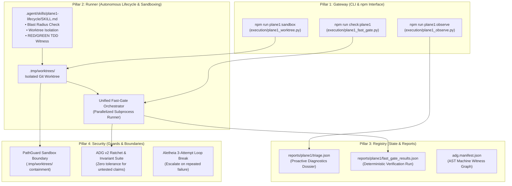

# Sovereign Blueprint: Plane 1 Lifecycle Engine (Top-Tier Hardening)

> [!IMPORTANT]
> **AI Context & Knowledge Heritage**
> - **Subsystem**: Core Sovereign Governance / Plane 1 Engine Maintenance
> - **Architecture**: `@docs ARCHITECTURE:Core`, `@docs ARCHITECTURE:Agent`, `@docs ARCHITECTURE:Sandboxing`
> - **Failure Path**: Verification sprawl, dirty working-tree corruption, silent invariant regressions, unverified bug fixes, agent context exhaustion.
> - **Observability**: Traceability via `execution/parity_guard.py` (`[Plane1Engine]`), `reports/plane1/triage.json`, and `reports/plane1/fast_gate_results.json`.

---

## 1. Executive Summary & Architectural Scope

This blueprint specifies the architecture, CLI contracts, deterministic sandboxing, and execution sequence required to elevate **Plane 1 (Sovereign Codebase Lifecycle Engine)** to an elite, top-tier self-maintenance system.

### Problem Vector
1. **Verification Sprawl**: Proving that an agent or developer change is 100% compliant requires manually executing five disjoint commands (`tsc -b`, `cargo check`, `adg:verify`, `vitest invariants`, `parity_guard.py`). If an agent omits any single check, silent compilation drift or documentation mismatch occurs.
2. **In-Place Mutation Vulnerability**: Plane 1 agents frequently modify files directly in the root working tree. When a complex refactor or build fails midway, uncommitted syntax errors and half-applied edits pollute the developer's workspace.
3. **Reactive-Only Blindness**: Plane 1 has no proactive awareness; it operates purely on prompt demand. Code rot, unused dependencies, Rust clippy warnings, and missing test witnesses accumulate until manually discovered.
4. **Unproven Fixes (Missing RED Witness)**: Agents often implement bug fixes without executing an upfront failing test witness (RED phase), leading to false-positive completions where underlying root causes remain unaddressed.

### Architectural Decisions (Locked via Socratic Gate)
1. **Implementation Layer (Layer 3 Deterministic Python)**: Build all execution tools as lightweight, dependency-free Python 3 scripts in `execution/` mapped to clean `npm run` scripts. This eliminates Cargo binary bloat and prevents engine recompile overhead.
2. **Hybrid Worktree Sandboxing**:
   - **Mandatory Worktree**: Any multi-file modification, structural refactor, or core engine logic edit must be executed within an isolated Git worktree (`.tmp/worktrees/<task-slug>`).
   - **Permitted In-Place**: Single-file documentation, markdown typos, and non-structural metadata edits may be applied directly.
3. **On-Demand & Pre-Push "Observe Mode"**: The diagnostic scanner (`execution/plane1_observe.py`) runs on-demand or as a pre-push hook. It assesses repo health, computes AST blast-radii, and writes a structured `reports/plane1/triage.json` without running costly background daemons.
4. **Phased Delivery**:
   - **Phase 1 (Immediate)**: Local Engineering Rigor (Fast-Gate + Worktree Sandbox + Observe Scanner + RED/GREEN Witness SOP).
   - **Phase 2 (Subsequent)**: Remote GitHub PR Event Loop (`followsDone` lifecycle, Before/After UI visual captures, and 3-round review bot circuit breakers).

---

## 2. The Sovereign 4-Pillar Architectural Breakdown



### Pillar 1: Gateway (Interfaces & Commands)
- **`npm run check:plane1`**: Invokes `execution/plane1_fast_gate.py`.
  - Arguments: `--strict` (fail on any warning), `--skip-rust` (fast frontend-only check), `--json` (machine-readable stdout for agents).
  - Target SLA: Total execution time $\le 10$ seconds on warm caches.
- **`npm run plane1:sandbox`**: Invokes `execution/plane1_worktree.py`.
  - Subcommands: `create <task>`, `test <task>`, `merge <task>`, `abort <task>`, `list`.
- **`npm run plane1:observe`**: Invokes `execution/plane1_observe.py`.
  - Scans repo health and outputs formatted terminal summary + `reports/plane1/triage.json`.

### Pillar 2: Runner (Deterministic Logic & Orchestration)
1. **Fast-Gate Parallel Pipeline**:
   - `Task 1 (Rust)`: `cargo check --manifest-path server-rs/Cargo.toml` (invoked via `cargo_fast_check.py` or direct cargo).
   - `Task 2 (TypeScript)`: `tsc -b && tsc -p tsconfig.test.json --noEmit`.
   - `Task 3 (ADG v2 Manifest & Lint)`: `node tools/adg/adg.mjs verify src/`.
   - `Task 4 (Executable Invariants)`: `npx vitest run tests/invariants/ --no-isolate`.
   - `Task 5 (Header Parity & Security)`: `python execution/parity_guard.py`.
   - All tasks execute concurrently via `ThreadPoolExecutor` or `asyncio.gather`. If any task fails, detailed error extraction parses the exact file and line for the LLM agent.

2. **Worktree Sandboxing Engine (`plane1_worktree.py`)**:
   - Resolves git root dynamically.
   - Ensures `.tmp/worktrees/` directory is present and git-ignored.
   - Creates new worktree: `git worktree add -b plane1/<task-slug> .tmp/worktrees/<task-slug> HEAD`.
   - Merging: Validates `plane1_fast_gate.py` inside the worktree $\rightarrow$ checks out base branch $\rightarrow$ squashes/merges branch $\rightarrow$ executes `git worktree remove --force .tmp/worktrees/<task-slug>` $\rightarrow$ deletes temporary branch.
   - Abort: Instantly forces removal and deletes the branch without leaving uncommitted files.

3. **Observe Diagnostic Engine (`plane1_observe.py`)**:
   - **AST Dead Code Detection**: Scans exports vs imports across `src/` and `server-rs/`.
   - **Rust Clippy Audit**: Runs non-blocking `cargo clippy --workspace --all-targets --message-format=json` to aggregate warnings.
   - **ADG Witness Verification**: Identifies newly added source files lacking corresponding unit tests or invariant links in `adg.manifest.json`.
   - **Prioritization Matrix**: Categorizes findings into P0 (Breaking/Invariant), P1 (Smell/Dead Code), P2 (Doc/Parity).

### Pillar 3: Registry (Persistence & Data Contracts)
- **`reports/plane1/triage.json`**:
  ```json
  {
    "timestamp": "2026-11-05T18:45:00Z",
    "git_head": "0a1b2c3d...",
    "health_score": 94,
    "issues": [
      {
        "id": "OBS-001",
        "category": "DeadCode",
        "priority": "P1",
        "file": "src/utils/legacyFormatter.ts",
        "description": "Exported symbol 'formatLegacy' has 0 internal callers",
        "blast_radius": "Low"
      }
    ],
    "summary": { "p0": 0, "p1": 1, "p2": 3 }
  }
  ```
- **`reports/plane1/fast_gate_results.json`**:
  Records timestamp, individual gate durations (ms), pass/fail status, and stdout/stderr snippets for agent telemetry.

### Pillar 4: Security & Operational Governance
- **Zero-Risk Rollbacks**: If an agent makes a syntax error or breaks an invariant in a worktree, `plane1_worktree.py abort` leaves the root tree 100% pristine.
- **Fail-Closed Gate**: No Plane 1 mission can be committed or merged if `plane1_fast_gate.py` returns non-zero.
- **Aletheia Circuit Breaker**: If `plane1_fast_gate.py` fails 3 consecutive times on the same task, the agent must halt and request human guidance rather than entering infinite repair thrashing.

---

## 3. Verification Mapping & Definition of Done

### Automated Parity Checks
- [ ] `execution/parity_guard.py` must index and verify headers for all new scripts in `execution/` and skills in `.agent/skills/`.
- [ ] `npm run adg:verify` must confirm 0 header lint violations and 0 manifest drift.
- [ ] `npm run test:invariants:fast` must pass 100% of invariant suites with 0 failures.

### Acceptance Criteria
1. **Speed & SLA**: `npm run check:plane1` executes in $\le 10$ seconds on a clean workspace.
2. **Worktree Isolation**: Creating a worktree, adding a test file, aborting, and checking `git status` leaves the main workspace with zero unstaged changes.
3. **Observe Output**: Running `npm run plane1:observe` generates `reports/plane1/triage.json` with clear, actionable diagnostics.
4. **Skill Governance**: `.agent/skills/plane1-lifecycle/SKILL.md` adheres to `agentskills.io` open specification with L1 YAML frontmatter and L2 action-first instructions.

---

## 4. Deterministic Task Sequence (Order of Operations)

| Step | Phase | Task Description | Target File(s) | Verification Command |
| :---: | :---: | :--- | :--- | :--- |
| **1** | **Fast Gate** | Create unified, parallelized pre-flight gate script | `execution/plane1_fast_gate.py` | `python execution/plane1_fast_gate.py` |
| **2** | **Scripts Entry** | Wire `check:plane1` into `package.json` | `package.json` | `npm run check:plane1` |
| **3** | **Sandbox Tool** | Create deterministic worktree sandbox manager | `execution/plane1_worktree.py` | `python execution/plane1_worktree.py list` |
| **4** | **Scripts Entry** | Wire `plane1:sandbox` into `package.json` | `package.json` | `npm run plane1:sandbox -- list` |
| **5** | **Observe Tool** | Create proactive observe-mode scanner | `execution/plane1_observe.py` | `python execution/plane1_observe.py` |
| **6** | **Scripts Entry** | Wire `plane1:observe` into `package.json` | `package.json` | `npm run plane1:observe` |
| **7** | **Skill SOP** | Author the Plane 1 Sovereign Lifecycle Skill | `.agent/skills/plane1-lifecycle/SKILL.md` | `python execution/verify_skill_specs.py` |
| **8** | **Governance** | Update `AGENTS.md` & `directives/IDENTITY.md` to reference the new Plane 1 gate and sandbox | `AGENTS.md`, `directives/IDENTITY.md` | `npm run adg:verify && python execution/parity_guard.py` |

---

## 5. Agent Resource & Skill Map

| Subsystem Task | Primary Specialist Agent | Required Skills |
| :--- | :--- | :--- |
| **Fast-Gate & Python Tooling** | `@nexus-engineer` | `python-patterns`, `clean-code`, `lint-and-validate` |
| **Git Worktree Sandboxing** | `@nexus-engineer` | `powershell-windows`, `bash-linux`, `simplify-code` |
| **Observe Mode Diagnostics** | `@qa-99` | `systematic-debugging`, `improve-codebase-architecture`, `adg-governance` |
| **Plane 1 Lifecycle Skill** | `@alpha-coordinator` | `aletheia-reasoning`, `tdd-workflow`, `code-review-graph` |

---

[OK] Sovereign Blueprint created: `docs/BLUEPRINT-plane1-lifecycle-engine.md`

