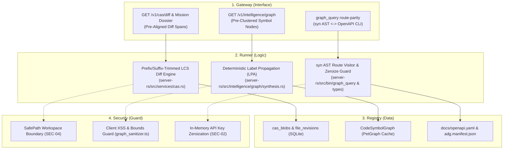

# 🏛️ Sovereign Blueprint: Lean 3-Phase Rust Modernization & Total Document Parity

> [!IMPORTANT]
> **AI Context & Knowledge Heritage**
> - **Subsystem**: Sovereign Architecture & Planning / Core Blueprints
> - **Architecture**: `@docs ARCHITECTURE:Core`, `@docs ARCHITECTURE:Security`, `@docs ARCHITECTURE:Retrieval`
> - **Failure Path**: Main-thread UI freezes on large CAS diffs, inaccurate bag-of-lines diff summaries, redundant client-side graph clustering, brittle regex route scanning, un-zeroized provider credentials in engine memory, or documentation drift.
> - **Observability**: Traceability via `execution/parity_guard.py` (`[BLUEPRINT-rust-migration-governance]`)

---

## 🎯 1. Executive Summary & Architectural Mandate

This blueprint specifies the **high-ROI 3-Phase Rust Modernization** across `server-rs` and `src/`, paired with a **100% zero-drift documentation synchronization ratchet** ensuring `docs/openapi.yaml`, `docs/API_REFERENCE.md`, `docs/API_CONTRACT.md`, `docs/ARCHITECTURE.md`, `docs/Architecture_Overview.md`, `docs/CODEBASE_MAP.md`, and `adg.manifest.json` remain strictly aligned with the codebase.

### Architectural Refinements (Evidence-Based ROI Selection)
1. **Phase 1 — Rust CAS Aligned Diff Engine (`server-rs` + `CAS_Diff_Inspector.tsx`)**:
   - Replaces the naive `HashMap<&str, usize>` bag-of-lines counter in `server-rs/src/routes/missions/dossier.rs` and the quadratic $O(M \times N)$ JavaScript 2D array in `src/components/missions/history/CAS_Diff_Inspector.tsx` with a prefix/suffix-trimmed Myers/LCS sequence alignment engine in Rust (`server-rs/src/services/cas.rs`), exposed both inline on `CasDiffRecord` and via `GET /v1/cas/diff`.
2. **Phase 2 — Server-Side Graph Community Clustering (`server-rs/src/intelligence/graph`)**:
   - Computes deterministic Label Propagation communities (with hub-node exclusion and majority-vote reattachment) directly on the `petgraph::DiGraph` in `server-rs` so `GET /v1/intelligence/graph` delivers pre-clustered `SymbolNode` payloads, while `graph_sanitizer.ts` retains its zero-trust XSS/bounds checks and uses pre-computed server communities automatically.
3. **Phase 3 — Native Rust AST Route Parity (`graph_query`) & Credential Memory Zeroization (`zeroize`)**:
   - Extends `server-rs/src/bin/graph_query` with a `route-parity` subcommand using `syn` (Rust AST) and `serde_norway` (OpenAPI YAML) to deterministically validate Axum routes against `docs/openapi.yaml` without fragile brace-counting regexes, and hardens `ProviderConfig` in `server-rs` with `zeroize` memory scrubbing.
4. **Deferred Low-ROI Work (`wasm-codec`)**:
   - `SwarmPulse` already streams compact 1–2 KB MessagePack frames at 10Hz (`0.03ms` decode in V8); `wasm-bindgen` string/vec cloning across FFI is omitted to avoid unnecessary bundler friction.

---

## 🏗️ 2. The Sovereign 4-Pillar Breakdown

---

## 🚀 3. Phased Execution Specification

### Phase 1: Rust CAS Aligned Diff Engine
- **Backend (`server-rs/src/services/cas.rs`, `routes/cas.rs`, `routes/missions/contracts.rs`, `routes/missions/dossier.rs`, `router.rs`)**:
  - Define `AlignedDiffLine` and `CasDiffResponse` structs.
  - Implement `compute_aligned_diff(pre: &str, cur: &str) -> (Vec<AlignedDiffLine>, CasDiffSummary)` in `server-rs/src/services/cas.rs` using common prefix/suffix stripping and bounded LCS dynamic programming so true sequence-aligned additions, deletions, and modifications are computed in native Rust.
  - Populate `aligned_lines` and accurate `diff_summary` on `CasDiffRecord` in `dossier.rs`.
  - Expose `GET /v1/cas/diff` in `routes/cas.rs` and wire into `router.rs` (`build_cas_routes`).
- **Frontend (`src/types/mission_dossier.ts`, `src/components/missions/history/CAS_Diff_Inspector.tsx`)**:
  - Add optional `aligned_lines?: AlignedDiffLine[]` to `CasDiffRecord`.
  - Update `CAS_Diff_Inspector.tsx` to render `active_diff.aligned_lines` directly when present, and upgrade client-side `compute_aligned_diff` with prefix/suffix trimming so large files with localized edits execute in $<1\text{ms}$.

### Phase 2: Server-Side Graph Community Clustering
- **Backend (`server-rs/src/intelligence/graph/models.rs`, `synthesis.rs`, `routes/intelligence.rs`)**:
  - Add `pub community: Option<usize>` to `SymbolNode`.
  - Implement deterministic Label Propagation community assignment (with hub-node exclusion for degree $>15$ and majority-vote reattachment) in `synthesis.rs` when synthesizing the `CodeSymbolGraph`.
- **Frontend (`src/components/intelligence/knowledge_graph/graph_sanitizer.ts`, `src/services/intelligence_api_service.ts`)**:
  - Preserve `sanitize_graph_data` security/XSS/bounds validation (`SanitizerIssue[]`).
  - Use server-provided `node.community` when present on sanitized nodes, falling back to client `compute_communities` only when raw nodes omit community IDs.

### Phase 3: Rust AST Route Parity (`graph_query`) & Credential Zeroization
- **Backend (`server-rs/src/bin/graph_query/main.rs`, `server-rs/src/types/agent.rs`, `execution/parity_guard.py`)**:
  - Add `route-parity` subcommand to `graph_query` using `syn` to parse `server-rs/src/router.rs` and `serde_norway` to parse `docs/openapi.yaml`, verifying bidirectional `CODE <-> OPENAPI` route parity.
  - Integrate `graph_query route-parity` into `execution/parity_guard.py` (with automatic fallback if binary is unbuilt).
  - Harden `ProviderConfig` / model credential structures with `zeroize::Zeroize` memory scrubbing helper methods when clearing or rotating credentials.

---

## 📋 4. Mandatory 100% Document Parity Matrix

| Document / Manifest | Phase 1 Updates | Phase 2 Updates | Phase 3 Updates |
| :--- | :--- | :--- | :--- |
| `docs/openapi.yaml` | Add `GET /v1/cas/diff` & `AlignedDiffLine` schema | Document `community` field on `SymbolNode` | Validated by `graph_query route-parity` |
| `docs/API_REFERENCE.md` | Auto-synced via `generate_api_reference.py --fix` | Auto-synced via `generate_api_reference.py --fix` | Verified 0 drift |
| `docs/API_CONTRACT.md` | Document `/v1/cas/diff` & `aligned_lines` contract | Document pre-clustered graph node contract | Verified 0 drift |
| `docs/ARCHITECTURE.md` | Update CAS Diff Engine architecture | Update Graph Synthesis community clustering | Update Governance & Zeroize sections |
| `docs/Architecture_Overview.md` | Note Rust CAS diff & dossier alignment | Note server-side PetGraph community synthesis | Note `graph_query route-parity` CLI |
| `docs/CODEBASE_MAP.md` | Update `cas.rs` & `CAS_Diff_Inspector.tsx` entries | Update `synthesis.rs` & `graph_sanitizer.ts` | Update `graph_query` & `parity_guard.py` |
| `adg.manifest.json` | Regenerate & verify via `adg.mjs` | Regenerate & verify via `adg.mjs` | Regenerate & verify via `adg.mjs` |
