# Sovereign Blueprint: Universal macOS Build (Apple Silicon & Intel)

> [!IMPORTANT]
> **AI Context & Knowledge Heritage**
> - **Subsystem**: Sovereign Deployment & Desktop Shell / macOS Universal
> - **Architecture**: `@docs ARCHITECTURE:DesktopShell`, `@docs ARCHITECTURE:Core`
> - **Failure Path**: Sidecar missing in `.app` bundle, permission denial on read-only `/Applications`, Gatekeeper quarantine failure, architecture slice mismatch in fat binary.
> - **Observability**: `sidecar_runtime.log` in App Support directory, GitHub Actions artifact verification.

---

## 1. Executive Summary & Architectural Scope

This blueprint defines the architecture, contracts, and deterministic execution plan for delivering a **Universal macOS Application (`.dmg` and `.app`)** for Tadpole OS from the existing unified repository.

The build will natively support both:
1. **Apple Silicon (`aarch64-apple-darwin`)**: M1, M2, M3, M4 series.
2. **Intel x86_64 (`x86_64-apple-darwin`)**: Legacy macOS hardware.

### Architectural Decisions (Locked via Socratic Gate)
1. **Repository Topology**: Unified Monorepo (No separate repository). Shared React 19 UI, shared Rust Axum engine, shared database models.
2. **Code Signing & Notarization**: **Ad-hoc signed; not notarized**. `bundle.macOS.signingIdentity: "-"` requests ad-hoc signing without Apple Developer credentials. Gatekeeper can still require operator approval.
3. **Data & Persistence Layout**: **Hybrid macOS Standard**. Defaults to `~/Library/Application Support/com.tadpole.os/` to avoid `/Applications` read-only failures, with explicit `TADPOLE_DATA_DIR` environment override for portable/testing workflows.
4. **CI/CD Execution**: Automated via **GitHub Actions** triggered on both tagged release commits (`v*`) and manual workflow dispatch (`workflow_dispatch`).

---

## 2. The Sovereign 4-Pillar Architectural Breakdown

```mermaid
graph TD
    subgraph "macOS Universal Architecture"
        UI["React 19 Frontend (WKWebView)"]
        TS["Tauri v2 Desktop Shell (Universal 2 Fat Binary)"]
        SC["Sidecar Engine: server-rs (Universal 2 Fat Binary via lipo)"]
        FS["Persistent State (~/Library/Application Support/com.tadpole.os/)"]
    end
    UI <-->|Tauri IPC Bridge / Neural Token| TS
    TS -->|Spawns & Monitors PID| SC
    UI <-->|HTTP / WebSocket (127.0.0.1:8000)| SC
    SC -->|SQLite WAL + Migrations| FS
    TS -->|Logs & PID Lock| FS
```

### Pillar 1: Gateway (Interface & Shell Presentation)
- **Runtime Webview**: macOS WKWebView powered by WebKit (standard Tauri v2 runtime on macOS).
- **Bundle Packaging**: 
  - Standard macOS `.app` bundle structure (`AI-Tadpole-OS.app/Contents/MacOS/`, `Contents/Resources/`).
  - Disk Image (`.dmg`) distribution with standard drag-to-Applications layout.
- **Window Governance**:
  - Window title: `AI-Tadpole-OS`.
  - Dimensions: Default `1280x720`, resizable; no minimum size is currently configured.
  - Native macOS menu bar support with standard shortcuts (`Cmd+Q` quit, `Cmd+W` close, `Cmd+C` copy, `Cmd+V` paste).
  - High-DPI / Retina asset rendering using `icons/icon.icns`.

### Pillar 2: Runner (Lifecycle & Sidecar Orchestration)
- **Sidecar Binary Name**: `server-rs-universal-apple-darwin` inside `src-tauri/bin/`.
- **Dual-Architecture Compilation & Lipo Splicing**:
  1. Compile `server-rs` with target `aarch64-apple-darwin`.
  2. Compile `server-rs` with target `x86_64-apple-darwin`.
  3. Splice both slices into a fat Mach-O binary using `lipo -create -output src-tauri/bin/server-rs-universal-apple-darwin`.
- **Process Management in `src-tauri/src/main.rs`**:
  - Single-instance detection using `.app.pid` in `Application Support`.
  - Stale sidecar cleanup on startup: graceful POSIX `SIGTERM` (`kill -15`) followed by polling and fallback `SIGKILL` (`kill -9`).
  - Clean shutdown handler on `RunEvent::ExitRequested` or `RunEvent::Exit`.
  - Sidecar health verification: loopback TCP polling against `http://127.0.0.1:8000/v1/engine/health` with bounded retry window.

### Pillar 3: Registry (Persistence & Data Directory Governance)
- **Read-Only App Bundle Protection**:
  On macOS, `/Applications/AI-Tadpole-OS.app` is read-only for standard users. The application MUST NOT attempt to write `.db`, `.log`, or `.neural_token` into the executable directory.
- **Path Resolution Matrix**:
  | Platform / Context | Resolved Data Directory | SQLite Location | Log Location |
  | :--- | :--- | :--- | :--- |
  | **macOS (Default)** | `~/Library/Application Support/com.tadpole.os/` | `~/Library/Application Support/com.tadpole.os/tadpole.db` | `~/Library/Application Support/com.tadpole.os/sidecar_runtime.log` |
  | **macOS (Custom)** | `$TADPOLE_DATA_DIR` (if set) | `$TADPOLE_DATA_DIR/tadpole.db` | `$TADPOLE_DATA_DIR/sidecar_runtime.log` |
  | **Windows / Linux** | `<exe_parent>` (Existing Portable Mode) | `<exe_parent>/tadpole.db` | `<exe_parent>/sidecar_runtime.log` |
- **Security Permissions**:
  - Data directory created with mode `0o700`.
  - `.neural_token` file written with POSIX mode `0o600` (Owner read/write only).

### Pillar 4: Security (Auth, Isolation & Gatekeeper Compliance)
- **Local Loopback Isolation**: Sidecar strictly binds to `127.0.0.1` (configurable via `BIND_ADDRESS`).
- **Neural Token Authentication**: Cryptographically generated 256-bit token passed from Tauri shell to webview via loopback IPC only.
- **Gatekeeper & Quarantine Handling**:
  - Tauri performs ad-hoc signing through `bundle.macOS.signingIdentity: "-"`. Packaging verifies the shell, engine and app signatures with `codesign --verify`.
  - Clear user guide in documentation for clearing quarantine:
    ```bash
    xattr -cr /Applications/AI-Tadpole-OS.app
    ```
- **Supply-Chain Dependency Audit**:
  - `server-rs/deny.toml` includes both `aarch64-apple-darwin` and `x86_64-apple-darwin`. Target inclusion is configuration evidence; a successful dependency audit must still be recorded.

---

## 3. Deterministic Task Sequence & Implementation Plan

```mermaid
gantt
    title macOS Universal Build Execution Sequence
    dateFormat  X
    axisFormat %s
    section Stage 1: Core Shell
    Data Path Governance in main.rs       :active, s1, 0, 10
    POSIX Process Signals & Cleanup Guard :active, s2, 10, 20
    section Stage 2: Tauri Config
    tauri.conf.json macOS & DMG Config   :s3, 20, 30
    Cargo Deny Target Alignment           :s4, 30, 35
    section Stage 3: CI/CD Pipeline
    GitHub Actions macOS Runner Job       :s5, 35, 50
    Lipo Sidecar Splicing Script          :s6, 50, 65
    section Stage 4: Verification
    Invariant Test for Path Resolution    :s7, 65, 80
    Documentation & User Guidance Docs    :s8, 80, 95
```



### Stage 1: Data Directory & Lifecycle Governance (`src-tauri/src/main.rs`)
1. Implement platform-conditional base directory resolution:
   - On `target_os = "macos"`: check an absolute `TADPOLE_DATA_DIR` environment override, otherwise use `$HOME/Library/Application Support/com.tadpole.os/`. `data_dir.rs` returns an error for missing HOME or relative paths instead of falling back into the bundle.
   - On Windows/Linux: maintain current portable `exe_path.parent()` behavior.
2. `prepare_data_dir` creates the directory before initializing SQLite paths, PID locks or log streams. Creation and permission failures stop startup. `.env` is loaded after path selection.
3. Verify POSIX permissions (`0o600` on `.neural_token`, `0o700` on data dir) under Unix.

### Stage 2: Tauri Configuration & Audit Alignment
1. **Update `src-tauri/tauri.conf.json`**:
   - Add `bundle.macOS` configuration specifying `minimumSystemVersion: "11.0"`.
   - Use Tauri's default DMG geometry; no custom installer background is configured.
2. **Update `server-rs/deny.toml`**:
   - Add `{ triple = "x86_64-apple-darwin" }` to `[graph.targets]` alongside existing `aarch64-apple-darwin`.

### Stage 3: Automated CI/CD Workflow (`.github/workflows/build.yml`)
1. Extend build matrix to include:
   ```yaml
   - platform: "macos-universal"
     os: macos-14 # GitHub-hosted M1 runner
     target: universal-apple-darwin
     suffix: ""
   ```
2. Add runner preparation steps:
   - Install Rust targets: `rustup target add aarch64-apple-darwin x86_64-apple-darwin`.
   - Build `server-rs` for `aarch64-apple-darwin` and `x86_64-apple-darwin`.
   - Execute `lipo -create` to generate `src-tauri/bin/server-rs-universal-apple-darwin`.
   - The workflow invokes `scripts/build-macos-universal.sh`, which runs `npx --no-install tauri build --target universal-apple-darwin -- --locked`, then `scripts/verify-macos-bundle.sh`.
3. Configure artifact upload paths:
   - `src-tauri/target/universal-apple-darwin/release/bundle/dmg/*.dmg`
   - The `.app` is verified before upload and distributed inside the `.dmg`; no `.app.tar.gz` upload is configured.

### Stage 4: Local Build Helper Script (`scripts/build-macos-universal.sh`)
1. Create a deterministic shell script for macOS developers to build locally in one command:
   - Pre-flight checks (`rustup`, `lipo`, Node.js).
   - Sidecar compilation and lipo stitching.
   - Tauri bundling.

### Stage 5: Invariant Testing & Parity Verification
1. Configuration checks live in `tests/invariants/inv_011_macos_bundle_invariants.test.ts`. Executable directory tests live in `src-tauri/src/data_dir.rs`, and mocked artifact failure tests in `scripts/tests/test_macos_bundle.py`:
   - Required targets exist in `tauri.conf.json`.
   - Correct binary naming convention for universal target.
   - Permissions and path fallback invariants.
2. Run `python execution/parity_guard.py`, `npm run adg:verify` and `npm run test:witness`. The release quality gate includes these checks and the packaging failure tests.

---

## 4. Agent Execution Map

| Task | Specialist Agent | Skill Sets Involved |
| :--- | :--- | :--- |
| Path resolution & POSIX signal handlers | `tauri-pro` & `rust-pro` | `tauri-pro`, `rust-pro`, `clean-code` |
| Tauri DMG & macOS bundle config | `tauri-pro` | `tauri-pro`, `lint-and-validate` |
| GitHub Actions CI multi-target lipo pipeline | `server-management` | `deployment-procedures`, `bash-linux` |
| Invariant test suite & supply-chain audit | `testing-rigor` | `testing-patterns`, `tdd-workflow` |
| Documentation & Gatekeeper bypass notes | `documentation-templates` | `documentation-templates` |

---

## 5. Verification Gate & Definition of Done

**Verification status, 2026-10-22:** Local configuration, directory-policy and mocked artifact-gate tests run on Windows. They do not establish a successful native macOS build. The inspected CI run predates this implementation and contains no macOS job. A native build and installed runtime verification remain required.

The Universal macOS implementation is ready for release only after:
- [ ] **Dual-Slice Verification**: `scripts/verify-macos-bundle.sh` passes on a fresh native build, requiring `x86_64` and `arm64` in both the shell named by `Info.plist` and the bundled `server-rs`, valid signatures, and a nonempty disk image.
- [ ] **Read-Only Installation Test**: App launches and operates normally when installed into a read-only simulated `/Applications` folder, writing all dynamic state into `~/Library/Application Support/com.tadpole.os/`.
- [ ] **Health Probe Convergence**: Installed application reaches engine readiness on loopback, successfully authenticates the UI, and stops its sidecar on quit. Record observed startup time; the current retry loop is not a five-second service guarantee.
- [ ] **Supply Chain Audit**: `cargo deny check` passes cleanly for both `aarch64-apple-darwin` and `x86_64-apple-darwin`.
- [ ] **CI Automation**: GitHub Actions workflow generates downloadable `.dmg` artifact on tagged releases and manual dispatch.
- [x] **ADG v2 Parity (local)**: ADG/witness verification and documentation parity pass in the local audit. This does not establish native build/runtime success.
