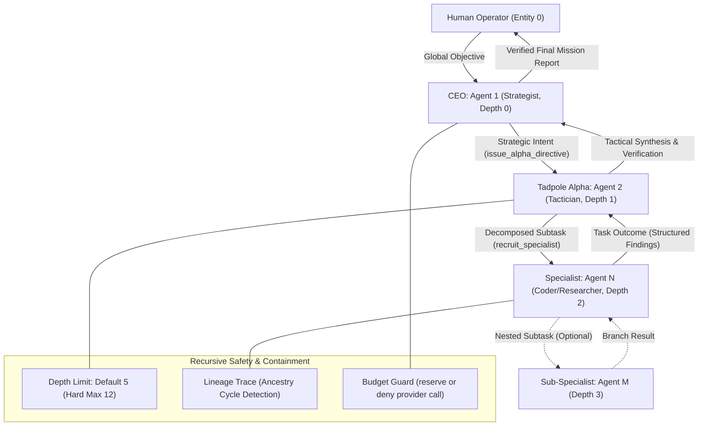

> [!IMPORTANT]
> **AI Context & Knowledge Heritage**
> - **Subsystem**: Architecture & Documentation / Core Docs / SWARM_ORCHESTRATION
> - **Architecture**: `@docs ARCHITECTURE:Documentation`
> - **Failure Path**: Information drift, legacy terminology, or documentation mismatch.
> - **Observability**: Traceability via `execution/parity_guard.py`

# Swarm Orchestration Guide
**Intelligence Level**: High (ECC Optimized)  
**Source of Truth**: [`server-rs/src/agent/runner/swarm/dispatcher.rs`](file:///d:/TadpoleOS-Dev/server-rs/src/agent/runner/swarm/dispatcher.rs), [`server-rs/src/agent/runner/swarm/recruitment.rs`](file:///d:/TadpoleOS-Dev/server-rs/src/agent/runner/swarm/recruitment.rs), [`server-rs/src/agent/runner/swarm/mod.rs`](file:///d:/TadpoleOS-Dev/server-rs/src/agent/runner/swarm/mod.rs), [`server-rs/src/agent/runner/workflow.rs`](file:///d:/TadpoleOS-Dev/server-rs/src/agent/runner/workflow.rs), [`server-rs/src/agent/runner/conductor.rs`](file:///d:/TadpoleOS-Dev/server-rs/src/agent/runner/conductor.rs), [`server-rs/src/security/metering.rs`](file:///d:/TadpoleOS-Dev/server-rs/src/security/metering.rs), [`server-rs/src/agent/runner/mod.rs`](file:///d:/TadpoleOS-Dev/server-rs/src/agent/runner/mod.rs)  
**Applies to Version**: 1.1.463+  
**Standard Compliance**: ECC-SWARM (Enhanced Contextual Clarity - Swarm Intelligence)

---

## Recursive Intelligence Model



---

## Table of Contents

- [0. System Roles & Glossary](#0-system-roles--glossary)
- [1. The Hierarchical Command Pattern](#1-the-hierarchical-command-pattern)
- [2. The Sovereignty Handoff Pattern](#2-the-sovereignty-handoff-pattern)
- [3. Shared Wisdom: The Context Bus](#3-shared-wisdom-the-context-bus)
- [4. Orchestration Mechanisms](#4-orchestration-mechanisms)
  - [4.1 Mechanism Selection Matrix](#41-mechanism-selection-matrix)
  - [4.2 Parallel Swarm Execution (PERF-06)](#42-parallel-swarm-execution-perf-06)
  - [4.3 Deterministic Pipeline Workflows (Engine-Level)](#43-deterministic-pipeline-workflows-engine-level)
  - [4.4 Conductor DAG Planning & Topological Scheduling](#44-conductor-dag-planning--topological-scheduling)
  - [4.5 Autonomous Background Missions (Continuity Scheduler)](#45-autonomous-background-missions-continuity-scheduler)
  - [4.6 Strategic Context Sandboxing](#46-strategic-context-sandboxing)
- [5. SME Data Intelligence & Memory](#5-sme-data-intelligence--memory)
  - [5.1 Hybrid RAG](#51-hybrid-rag)
  - [5.2 Background Data Connectors](#52-background-data-connectors)
  - [5.3 Markdown SOP Workflows](#53-markdown-sop-workflows)
  - [5.4 Layout-Aware Ingestion](#54-layout-aware-ingestion)
  - [5.5 Persistent Vector Memory (LanceDB)](#55-persistent-vector-memory-lancedb)
- [6. Designing a Mission](#6-designing-a-mission)
  - [Phase A: Discovery (Depth 0–1)](#phase-a-discovery-depth-01)
  - [Phase B: Parallel Recruitment (Depth 2)](#phase-b-parallel-recruitment-depth-2)
  - [Phase C: Tactical Synthesis & Verification](#phase-c-tactical-synthesis--verification)
  - [Phase D: Working Memory Persistence](#phase-d-working-memory-persistence)
- [7. Orchestration Safety & Financial Guardrails](#7-orchestration-safety--financial-guardrails)
  - [7.1 The Budget Gate & Spending Limits](#71-the-budget-gate--spending-limits)
  - [7.2 Failure Handling & Circuit Breaker](#72-failure-handling--circuit-breaker)
  - [7.3 Loop Prevention & Lineage Chains](#73-loop-prevention--lineage-chains)
  - [7.4 Capability Oversight & Lifecycle](#74-capability-oversight--lifecycle)
  - [7.5 Shared Tool Cache & Conflict Leases](#75-shared-tool-cache--conflict-leases)
  - [7.6 Security, Integrity & Sandboxing](#76-security-integrity--sandboxing)
- [8. Swarm Observability](#8-swarm-observability)
  - [8.1 Swarm Pulse: Binary Telemetry Pipeline](#81-swarm-pulse-binary-telemetry-pipeline)
  - [8.2 The Swarm Visualizer (Force Graph)](#82-the-swarm-visualizer-force-graph)
  - [8.3 Neural Waterfall Streaming](#83-neural-waterfall-streaming)
  - [8.4 RESTful Observability & RFC 9457](#84-restful-observability--rfc-9457)
  - [8.5 The Neural Map](#85-the-neural-map)
  - [8.6 Mission Analysis & Behavioral Drift](#86-mission-analysis--behavioral-drift)
- [9. Swarm Proposal & Optimization](#9-swarm-proposal--optimization)
- [10. Multi-Node Bunker Infrastructure](#10-multi-node-bunker-infrastructure)
- [11. Workspace File Operations in Swarms](#11-workspace-file-operations-in-swarms)
- [12. Swarm Efficiency Checklist](#12-swarm-efficiency-checklist)
- [Appendix A: Operational Limits & Defaults](#appendix-a-operational-limits--defaults)

---

## 0. System Roles & Glossary

To maintain unambiguous documentation parity across human operators and AI agents, the following terminology is standardized:

| Canonical Term | Identifier / ID | Role & Responsibilities | Aliases in Documentation |
|---|---|---|---|
| **Human Operator** | `Entity 0` | The human user interacting via chat, voice, or dashboard. External to the recursion stack. | User, Human-in-the-loop, Operator |
| **CEO** | `Agent 1` | Top-level strategic orchestrator (Depth 0). Receives human intent and formulates high-level directives. | Sovereign, Strategist, Agent of Nine |
| **Alpha Node** | `Agent 2` | Tactical coordinator (Depth 1). Decomposes directives into subtasks, recruits specialists, and synthesizes results. | COO, Tactician, Tadpole Alpha |
| **Specialist** | `Agent N` | Domain-specific executor (Depth 2+). Focused on isolated execution (e.g., coding, research, auditing). | Sub-agent, Worker Node |
| **Success Auditor** | `Agent 99` | Post-mission debrief agent. Analyzes completed runs, identifies drift, and updates persistent memory. | Mission Analyst |
| **Mission Cluster** | Dynamic UUID | A functional grouping of agents and workspace sandboxes dedicated to a domain or workflow. | Swarm, Department |
| **WorkflowRun** | Numeric ID | A single execution instance of a deterministic pipeline or Conductor plan. | Pipeline Run |
| **Bunker** | Network Node | A sovereign host machine running an instance of the Tadpole OS engine. | Node, Secondary Node |

---

## 1. The Hierarchical Command Pattern

Tadpole OS enforces a strict command hierarchy to prevent **Swarm Drift** (loss of the initial objective across deep multi-agent delegation chains):

1. **CEO (Agent 1)**: Operates at recursion **Depth 0**. Analyzes raw user goals, applies business logic, and delegates tactical execution to the TadpoleAlpha via `issue_alpha_directive`.
2. **Tadpole Alpha (Agent 2)**: Operates at recursion **Depth 1**. Manages subtask breakdown, schedules parallel specialists via `recruit_specialist` (or the underlying `spawn_subagent` tool), and synthesizes branch outcomes.
3. **Specialists (Agent N)**: Operate at recursion **Depth 2+**. Specialized agents with distinct model parameters, system prompts, and toolsets. Specialists execute domain tasks and return bounded structured findings to the calling Alpha Node. Specialists are recruited through standardized agent registry lookups and execute tools managed by the engine's Model Context Protocol (MCP) host.

---

## 2. The Sovereignty Handoff Pattern

The Sovereignty Handoff pattern enables end-to-end mission execution from concise operator prompts with zero micromanagement:

- **Protocol Flow**:
  1. The Human Operator speaks or types a high-level goal to the system.
  2. The Voice Interface (Local Whisper or remote Groq) transcribes the prompt.
  3. The **CEO (Agent 1)** receives the transcript, formats the tactical payload, and invokes `issue_alpha_directive`.
  4. The **Tadpole Alpha (Agent 2)** receives the structured directive and immediately initiates cluster scheduling.

> [!IMPORTANT]
> **Neural Lineage Schema Required** *(IDENTITY.md Directive #2)*  
> Every `issue_alpha_directive` handoff payload must include the core fields of the Neural Lineage Schema:
> 1. `[Task-Slug]`: A kebab-case unique identifier for the mission subtask.
> 2. `[Execution-Plane]`: `Engine-Maintenance` (Plane 1) or `SMB-Digital-Twin` (Plane 2 target; a handoff label does not enforce `FR-11`).
> 3. `[Current State]`: The active phase and runtime preconditions.
> 4. `[Operation-Counter]`: `0-10` counter (resets upon Directive #8 Compliance Heartbeat).
> 5. `[Verified Facts]`: Deterministically confirmed data points and dependencies.
> 6. `[Pending Blockers]`: Open risks, missing inputs, or unresolved errors.
> 7. `[Next Actionable Step]`: The immediate tactical instruction for the receiving node.  
> 
> Partial handoffs that omit any of these fields are rejected by the lineage validator.

> [!WARNING]
> **Plane 2 is preview-only until company-scoped runtime support exists.** The generic runner rejects only identities whose stored `department` exactly matches `Plane 2: SMB-Digital-Twin` (case-insensitive); other labels do not trigger the guard. Do not dispatch live business workflows or persist customer data based on a handoff label. Use synthetic inputs and stop at preview.

---

## 3. Shared Wisdom: The Context Bus

Agents do not use unmonitored private channels; they publish structured findings to the shared mission context bus:
- **Source Citations**: Every reported finding must include concrete citations (file paths, tool outputs, or URLs).
- **Synthesis Turns**: The Alpha Node uses dedicated reasoning turns to resolve conflicting findings before presenting the final deliverable.
- **Bounded Retention**: Telemetry and findings are indexed in the mission ledger rather than copied verbatim across all context windows.

---

## 4. Orchestration Mechanisms

Tadpole OS provides four distinct mechanisms for multi-agent coordination.

### 4.1 Mechanism Selection Matrix

| Mechanism | Configuration Location | Execution Sequencing | Concurrency Control | Best Used For |
|---|---|---|---|---|
| **Ad-Hoc Recruitment** | Dynamic at runtime | Model-driven loop | Bounded fan-out (max 8 targets) | Exploratory research, debugging, dynamic task delegation |
| **Deterministic Workflows** | Database / `WorkflowRun` | Fixed numerical `order` | Parallel within step, sequential across steps | Repeatable pipelines, compliance checklists, onboarding |
| **Conductor DAG** | Runtime plan validation | Topological DAG sort | Concurrent execution of independent branches | Complex multi-stage engineering goals with known dependencies |
| **Continuity Scheduler** | SQLite cron jobs table | Cron intervals (`0 * * * *`) | Background runner pool (`MAX_CONCURRENT_RUNNERS`) | Recurring maintenance, passive sync, autonomous monitoring |

### 4.2 Parallel Swarm Execution (PERF-06)

The engine supports bounded concurrent tool execution:
- **Bounded Fan-Out**: A single recruitment call accepts at most **8 unique targets**, and a single model turn accepts at most **16 parallel tool calls**.
- **Global Hardware Ceiling**: The `MAX_CONCURRENT_RUNNERS` environment variable (default: 4) bounds the total active Tokio tasks across root agents and nested branches combined.
- **Deadlock Mitigation**: Waiting parent agents yield execution slots while awaiting child branch results, preventing nested recruitment chains from exhausting the runner pool.
- **Shared Budget Allocation**: Sibling branch allowances divide the parent's remaining budget; aggregate branch allocations cannot exceed the parent's unspent balance.
- **Structured Fan-In**: Every child branch reports an explicit status: `completed`, `failed`, `blocked`, or `cancelled`. Failure output is never silently treated as success.

### 4.3 Deterministic Pipeline Workflows (Engine-Level)

Managed by the continuity engine (`server-rs/src/agent/continuity/`), deterministic workflows execute predefined pipelines where ordering and data passing must be strictly guaranteed.

#### Workflow Schema
```json
{
  "name": "Market Analysis Pipeline",
  "steps": [
    {
      "order": 1,
      "agent_id": 5,
      "prompt": "Research current AI trends in enterprise infrastructure.",
      "context_injection": "full"
    },
    {
      "order": 2,
      "agent_id": 1,
      "prompt": "Synthesize the findings from Step 1 into a strategic executive summary.",
      "context_injection": "previous_findings"
    }
  ]
}
```

#### Context Injection Principles
- **Delimited User Context**: Previous findings are injected into the user task prompt wrapped within explicit delimiters (`### PREVIOUS STEPS FINDINGS:`), preserving system prompt authority and preventing prompt injection from external web data.
- **Unified Audit Trail**: A `WorkflowRun` retains a single mission ID, ensuring that all step transactions are recorded in the cryptographically chained Merkle ledger.

### 4.4 Conductor DAG Planning & Topological Scheduling

When a high-level objective requires multi-step orchestration with non-linear dependencies, the **Conductor Engine** ([`server-rs/src/agent/runner/conductor.rs`](file:///d:/TadpoleOS-Dev/server-rs/src/agent/runner/conductor.rs)) generates and executes a Directed Acyclic Graph (DAG).

- **DAG Step Definition**: Each step specifies a unique ID, model/agent assignment, prompt, and an explicit list of predecessor step IDs (`dependencies`).
- **Topological Sorting**: The engine executes Kahn's algorithm to compute the execution order. If a circular reference is detected, the plan is rejected immediately before any LLM calls or tool actions execute.
- **Step Cap**: Plans are constrained to a maximum of **16 validated steps**.
- **Failure Isolation**: If a step fails, dependent downstream steps are marked `blocked`. Unrelated independent branches continue execution, allowing partial progress to be reviewed by the operator.

### 4.5 Autonomous Background Missions (Continuity Scheduler)

Proactive and recurring tasks run via the Continuity Scheduler:
- **Cron Scheduling**: Standard Unix cron expressions (e.g., `0 */2 * * *`) trigger automated runs in the background.
- **Schedule Helper UI**: The Configure New Job card integrates a visual schedule assistant ([`Cron_Config_Mini_Panel`](../src/components/scheduler/Cron_Config_Mini_Panel.tsx)) that converts recurring frequency intervals (minutes, hours, days, months) and targeted calendar dates/times into standard 5-part cron syntax with UTC and local timezone conversion and live schedule estimation ([`cron_builder`](../src/utils/cron_builder.ts)).
- **Spending Bounds**: Each background job is assigned an explicit `budgetUSD` ceiling.
- **Circuit Breaker**: If a scheduled job encounters consecutive failures exceeding `maxFailures` (default: 3), the scheduler marks the job as `suspended` and alerts the operator.
- **Suspension Recovery**: Suspended jobs can be un-suspended through the Continuity UI or by issuing an administrative REST API update.

### 4.6 Strategic Context Sandboxing

To eliminate token bloat and prevent cross-branch context contamination, the engine enforces strict context boundary filtering when spawning sub-agents:
- **Transcript Filtering**: The parent agent's internal reasoning chains, raw tool execution traces, and debugging telemetry are stripped before the child agent launches.
- **Strategic Intent Forwarding**: The child receives only the bounded payload necessary for execution:
  - `primary_goal`: High-level mission objective (capped at 1,024 characters).
  - `recent_findings`: Synthesized parent discoveries (capped at 2,048 characters).
  - `visible_transcript`: The last 6 conversation exchanges (capped at 4,096 characters per message).

---

## 5. SME Data Intelligence & Memory

Swarm agents access institutional domain knowledge through a modular 4-phase data layer.

### 5.1 Hybrid RAG
When an agent calls `search_mission_knowledge`, the query is evaluated using dual-signal retrieval: vector cosine similarity combined with BM25 keyword proximity. This prevents hallucinations when querying technical or domain-specific documentation.

### 5.2 Background Data Connectors
Agents can attach to local directory paths configured via **Connector Configs**. A background Tokio ingestion daemon periodically scans configured sources and embeds updated files into the agent's vector store.
- **SyncManifest**: Uses file modification time (`mtime`) and SHA-256 checksums to avoid re-embedding unchanged files.
- **Crawl Cadence**: Controlled by the `SME_SYNC_INTERVAL_MINS` environment variable (default: 30 minutes).
- **Filesystem Isolation**: Connector paths must resolve within the configured `RESOURCE_ROOT` or cluster workspace directory. Paths outside designated roots are rejected.

### 5.3 Markdown SOP Workflows
For repeatable standard operating procedures, agents execute Markdown SOP files located in `data/workflows/*.md` ([`server-rs/src/agent/runner/workflow.rs`](file:///d:/TadpoleOS-Dev/server-rs/src/agent/runner/workflow.rs)). Each step represents an ordered procedural instruction with explicit inputs and expected outputs.

### 5.4 Layout-Aware Ingestion
The file parser ([`server-rs/src/agent/parser.rs`](file:///d:/TadpoleOS-Dev/server-rs/src/agent/parser.rs)) preserves document hierarchy (markdown headings, table structures, CSV rows, and code blocks) during chunking, producing higher-fidelity search chunks than fixed character-count splitting.

### 5.5 Persistent Vector Memory (LanceDB)
Terminal mission findings are stored in a persistent LanceDB directory (`memory.lance`). At mission start, relevant context is loaded into a session-scoped table (`scope.lance`), allowing cross-session recall without saturating context windows.

---

## 6. Designing a Mission

Follow this 4-phase template for reliable multi-agent execution:

```
[Phase A: Discovery]  ──►  [Phase B: Parallel Recruitment]  ──►  [Phase C: Tactical Synthesis]  ──►  [Phase D: Memory Persistence]
    (Depth 0–1)                   (Depth 2)                             (Depth 1)                         (Depth 1)
```

### Phase A: Discovery (Depth 0–1)
The Human Operator (`Entity 0`) provides the global objective to the CEO (`Agent 1`, Depth 0), who refines it and delegates to the Alpha Node (`Agent 2`, Depth 1):
```text
Operator -> CEO: "Analyze the security and latency trade-offs of WebAssembly runtimes in edge infrastructure."
CEO -> Alpha Node: issue_alpha_directive with 5-field Neural Lineage Schema.
```

### Phase B: Parallel Recruitment (Depth 2)
The Alpha Node decomposes the objective and recruits specialized agents using the `recruit_specialist` tool:
```json
// Subtask 1: Performance Analysis
recruit_specialist({
  "agent_id": "wasm_perf_specialist",
  "message": "Benchmark cold-start and memory footprints of Wasmtime vs WAMR."
})

// Subtask 2: Security Analysis
recruit_specialist({
  "agent_id": "sec_audit_specialist",
  "message": "Evaluate capability-based security isolation and memory sandboxing in Wasmtime."
})
```

### Phase C: Tactical Synthesis & Verification
The Alpha Node waits for all parallel branch outcomes. It correlates findings, detects inconsistencies, verifies that all requested metrics are covered, and produces a consolidated report. If any specialist branch fails, the Alpha attempts a retry or pauses for operator intervention.

### Phase D: Working Memory Persistence
The Alpha Node updates the persistent mission scratchpad via `update_working_memory`. Key discoveries are persisted to `memory.lance` so they remain accessible to subsequent missions without re-running research.

---

## 7. Orchestration Safety & Financial Guardrails

### 7.1 The Budget Gate & Spending Limits
- **Budget Defaults**: Newly encountered agents default to `$0.50` USD and missions/clusters default to `$5.00` USD (`DEFAULT_AGENT_BUDGET_USD`, `DEFAULT_MISSION_BUDGET_USD`). Explicit quota and mission `budget_usd` settings apply where configured.
- **Budget Enforcement**: Estimated provider-call cost is reserved against both the agent quota and the mission/cluster quota before dispatch. The runner also applies a branch sub-budget when one is supplied in the run context. If either reservation fails, that provider call is rejected with `BUDGET_EXHAUSTED` (HTTP 402).
- **Scope Limitation**: Budget exhaustion does not suspend other agents, create a system-wide `STASIS` state, write a special budget snapshot, emit a `BUDGET_BREACH` alert, or require a global `RESUME`/`TERMINATE` command. Those remain governance requirements, not runtime behavior.

### 7.2 Failure Handling & Circuit Breaker
- **Fail-Fast Isolation**: Provider API errors or model timeouts trigger an immediate runner pause and emit a `system:message` notification.
- **Parent Ownership**: Child specialists cannot unilaterally mark a mission completed or failed. Partial fan-in outcomes pause the parent agent, presenting the operator with explicit `Retry`, `Resume`, or `Close` controls.
- **Step Timeouts**: Tool execution times out after 30 seconds; agent reasoning steps time out after 300 seconds (`WORKFLOW_AGENT_TIMEOUT_SECS`); background continuity jobs time out after 900 seconds (`CONTINUITY_JOB_TIMEOUT_SECS`).

### 7.3 Loop Prevention & Lineage Chains
- **Lineage Chain Tracking**: The engine maintains a caller chain for every active turn (e.g., `Agent 1 -> Agent 2 -> Agent 5`). Any attempt to recruit an agent that already exists in its own ancestry is rejected with a `LineageRecursionError`.
- **Recursion Limits**: Recursion depth defaults to **5** (`MAX_SWARM_DEPTH`), with a hard system ceiling of **12** (`MAX_RECRUITMENT_DEPTH` in [`server-rs/src/agent/runner/swarm/mod.rs`](file:///d:/TadpoleOS-Dev/server-rs/src/agent/runner/swarm/mod.rs)). Recruitment calls at the maximum depth are rejected.
- **Model Inheritance**: Recruited specialists retain their registered model and credentials. When an agent node lacks explicit model configuration, it inherits provider and model settings from the recruiting parent.

### 7.4 Capability Oversight & Lifecycle
- **Skill Proposals**: Agents proposing new tools or workflows invoke `propose_capability`. The proposal enters the **Oversight Dashboard** in `Prompt` mode (`permission_policies` table).
- **Mandatory Approval**: Autonomous skill registration without operator approval is prohibited. The skill manifest is written to disk and loaded into the `CapabilitiesRegistry` only after explicit human authorization.
- **Gated Permissions**: Tools requiring `budget:spend` or `shell:execute` permissions, as well as agents configured with `requires_oversight: true`, mandate human approval for each invocation.

### 7.5 Shared Tool Cache & Conflict Leases
- **Idempotent Tool Cache**: Read-only tool calls (e.g., file reads, code graph lookups) are cached by the `SharedToolCache`. Cache hits verify file modification time (`mtime`) and byte size. Cache hits do not incur duplicate token metering charges.
- **Workspace Conflict Leases**: Mutating operations lease file paths through the `ConflictManager`. Active leases have a **30-second TTL** to prevent deadlocks from unhandled exceptions. Simultaneous write requests to an active leased path return retryable conflict responses.

### 7.6 Security, Integrity & Sandboxing
- **Merkle Ledger**: Every mission action, state transition, and tool call is recorded with a cryptographic signature chain. Any ledger tampering flags an integrity violation in the audit log.
- **Memory Pressure Monitoring**: The engine monitors host RAM utilization during high-concurrency operations. If host memory approaches critical limits, new branch spawning is throttled to prevent Out-Of-Memory (OOM) faults.
- **Workspace File Path Checks**: Runner workspace file operations use `data/workspaces/<cluster-id>/` as the cluster root and reject path traversal outside the configured workspace. This does not provide company/tenant isolation or restrict every other tool and network path.

---

## 8. Swarm Observability

### 8.1 Swarm Pulse: Binary Telemetry Pipeline
The engine streams real-time swarm topology updates over the WebSocket connection using a compact binary protocol:
- **Encoding**: Frames are encoded via `rmp-serde` (MessagePack) and prefixed with the byte header `0x02`.
- **Broadcast Cadence**: Telemetry pulses broadcast at **10 Hz (100 ms intervals)**, ensuring real-time dashboard responsiveness without network saturation.
- **Telemetry Payload**: Each frame includes active agent states, role IDs, recruitment edges, and operational health indicators.

### 8.2 The Swarm Visualizer (Force Graph)
Located on the **Engine Dashboard**, the Swarm Visualizer renders cluster topology using a 2D force-directed graph:
- **Node Statuses**: Agents display status indicators reflecting their execution state:
  - *Cyan / Thinking*: Actively executing LLM inference or tool calls.
  - *Zinc / Idle*: Awaiting directives or subtask results.
  - Budget exhaustion is reported for the affected run; the UI does not expose a system-wide STASIS state.
  - *Red / Error*: Encountered an unhandled exception or failed step.
- **Detachable Portal**: Operators can detach the visualizer into an independent browser window for multi-display operations.
- **Interactive Focus**: Clicking an agent node focuses its active execution transcript in the chat interface.

### 8.3 Neural Waterfall Streaming
LLM responses stream to the client incrementally using Server-Sent Events (SSE) and WebSocket channels, rendering generated tokens and intermediate status indicators without waiting for turn completion.

### 8.4 RESTful Observability & RFC 9457
API resources include standard HATEOAS navigation links (`_links`) for available operations (`pause`, `resume`, `terminate`). Errors follow the **RFC 9457 Problem Details** specification:
```json
{
  "type": "https://tadpole.os/errors/budget-exhausted",
  "title": "Budget Exhausted",
  "status": 402,
  "detail": "Agent or mission spend budget exhausted.",
  "instance": "/v1/agents/{id}/tasks"
}
```

### 8.5 The Neural Map
The Mission Cluster screen includes an interactive **Neural Map** rendering dynamic SVG connection traces between Alpha coordinators and active specialists, illustrating cluster utilization and communication topology at a glance.

### 8.6 Mission Analysis & Behavioral Drift
When a mission finishes, the **Success Auditor (Agent 99)** executes an automated debrief:
- **Semantic Pruning**: Distills multi-turn logs into concise summaries of key blockers, decisions, and outcomes.
- **Pattern Matching**: Compares errors against historical runs in `memory.lance` to highlight recurring issues.
- **Behavioral Drift Checks**: Compares final deliverables against the agent's core identity prompt to detect behavioral or policy drift.

---

## 9. Swarm Proposal & Optimization

The engine analyzes incoming mission objectives using keyword heuristics to suggest cluster configurations:
- **Heuristic Triggers**:
  - Keywords such as `security`, `audit`, or `vault` suggest security-focused specialists and verification tools.
  - Keywords such as `scale`, `benchmark`, or `performance` suggest high-throughput parallel swarming topologies.
- **Optimization Workflow**:
  1. The engine generates a `SwarmProposal` upon mission creation.
  2. A proposal indicator appears on the cluster view.
  3. The operator reviews the proposed configuration and either authorizes or dismisses the suggestion.
- **Cluster Management**: Cluster definitions and layout settings are managed via the dashboard. Frontend view states are cached in browser `localStorage`, while cluster definitions, workspace files, and quotas are persisted in the SQLite database and filesystem.

---

## 10. Multi-Node Bunker Infrastructure

Tadpole OS supports distributed swarms spanning multiple sovereign nodes ("Bunkers"):
- **Discovery**: The **Discover Nodes** action on the Operations dashboard scans the local network for secondary bunkers.
- **Authentication**: Cross-bunker communication requires mutual authentication via configured **Neural Engine Access Tokens** (`NEURAL_ENGINE_ACCESS_TOKEN`).
- **Unified Management**: Discovered nodes register with the primary dashboard, enabling coordinated multi-host swarm execution from a central interface.

---

## 11. Workspace File Operations in Swarms

Specialists collaborate on shared files within their cluster's workspace directory (`data/workspaces/<cluster-id>/`).

### Collaborative Pipeline Example
```text
Specialist A:           web_search  ──► write_file("raw_research.md")
Specialist B (after A): read_file("raw_research.md") ──► write_file("analysis.md")
Alpha Node   (after B): read_file("analysis.md")     ──► write_file("final_report.md")
                                                     ──► archive_to_vault("final_report.md")
```

- **Execution Order**: Explicit task dependencies (via deterministic workflow `order` or Conductor DAG `dependencies`) establish the execution sequence.
- **Concurrency Protection**: The `ConflictManager` issues 30-second lease locks on active paths, preventing concurrent write collisions.
- **File Deletions**: Deletion operations (`delete_file`) always mandate human operator approval via the Oversight Gate.

---

## 12. Swarm Efficiency Checklist

Before deploying complex multi-agent swarms, verify the following operational items:

- [ ] **CEO Model**: Is the CEO (Agent 1) configured with an appropriate model and temperature for strategic planning?
- [ ] **Specialist Models**: Do data extraction and coding specialists use low-temperature models for deterministic execution?
- [ ] **Budget Cap**: Is an explicit `budget_usd` assigned, or is the default `$0.50` USD ceiling appropriate?
- [ ] **Tool Least-Privilege**: Are high-privilege tools (`fetch_url`, `shell:execute`, `delete_file`) restricted to only the specialists that require them?
- [ ] **Rate Limits & Pricing**: Are model rate limits (RPM/TPM) and token prices configured in the Model Registry?
- [ ] **Workspace Path Scope**: Do file-mutating specialists operate within a designated cluster workspace (`data/workspaces/<cluster-id>/`)? This path scope is not company/tenant isolation.
- [ ] **Synthesis Instructions**: Does the Alpha Node prompt emphasize synthesis, conflict resolution, and citation verification?
- [ ] **Branch Timeouts**: Are step timeouts (`WORKFLOW_AGENT_TIMEOUT_SECS`) aligned with the expected duration of child tasks?

---

## Appendix A: Operational Limits & Defaults

| Parameter / Limit | Default Value | Hard Ceiling / Behavior | Source Reference |
|---|---|---|---|
| **Max Recruitment Depth** | `5` | Hard limit `12` (`MAX_RECRUITMENT_DEPTH`); deeper recruitment blocked | [`server-rs/src/agent/runner/swarm/mod.rs`](file:///d:/TadpoleOS-Dev/server-rs/src/agent/runner/swarm/mod.rs) |
| **Max Fan-Out Targets** | `8` | Excess recruitment targets rejected | [`server-rs/src/agent/runner/swarm/dispatcher.rs`](file:///d:/TadpoleOS-Dev/server-rs/src/agent/runner/swarm/dispatcher.rs) |
| **Max Parallel Tool Calls** | `16` | Capped per LLM turn | [`server-rs/src/agent/runner/swarm/dispatcher.rs`](file:///d:/TadpoleOS-Dev/server-rs/src/agent/runner/swarm/dispatcher.rs) |
| **Max Conductor Steps** | `16` | Plans exceeding 16 steps rejected | [`server-rs/src/agent/runner/conductor.rs`](file:///d:/TadpoleOS-Dev/server-rs/src/agent/runner/conductor.rs) |
| **Default Agent Budget** | `$0.50` USD | Denies provider calls that cannot reserve quota; no global STASIS mode | [`server-rs/src/security/metering.rs`](../server-rs/src/security/metering.rs) |
| **File Lease Lock TTL** | `30` seconds | Auto-releases on expiration | [`server-rs/src/security/conflict.rs`](file:///d:/TadpoleOS-Dev/server-rs/src/security/conflict.rs) |
| **Telemetry Pulse Rate** | `10` Hz (100 ms) | WebSocket binary stream cadence | [`server-rs/src/routes/ws/telemetry.rs`](../server-rs/src/routes/ws/telemetry.rs) |
| **SME Ingestion Sync** | `30` minutes | Controlled via `SME_SYNC_INTERVAL_MINS` | [`server-rs/src/agent/runner/mod.rs`](file:///d:/TadpoleOS-Dev/server-rs/src/agent/runner/mod.rs) |
| **Max Concurrent Runners** | `4` | Bound via `MAX_CONCURRENT_RUNNERS` | [`server-rs/src/agent/runner/mod.rs`](file:///d:/TadpoleOS-Dev/server-rs/src/agent/runner/mod.rs) |
| **Tool Execution Timeout** | `30` seconds | Fails with timeout error | [`server-rs/src/agent/runner/mod.rs`](file:///d:/TadpoleOS-Dev/server-rs/src/agent/runner/mod.rs) |
| **Agent Step Timeout** | `300` seconds | Controlled via `WORKFLOW_AGENT_TIMEOUT_SECS` | [`server-rs/src/agent/runner/mod.rs`](file:///d:/TadpoleOS-Dev/server-rs/src/agent/runner/mod.rs) |
| **Continuity Job Timeout** | `900` seconds | Controlled via `CONTINUITY_JOB_TIMEOUT_SECS` | [`server-rs/src/agent/continuity/mod.rs`](file:///d:/TadpoleOS-Dev/server-rs/src/agent/continuity/mod.rs) |
