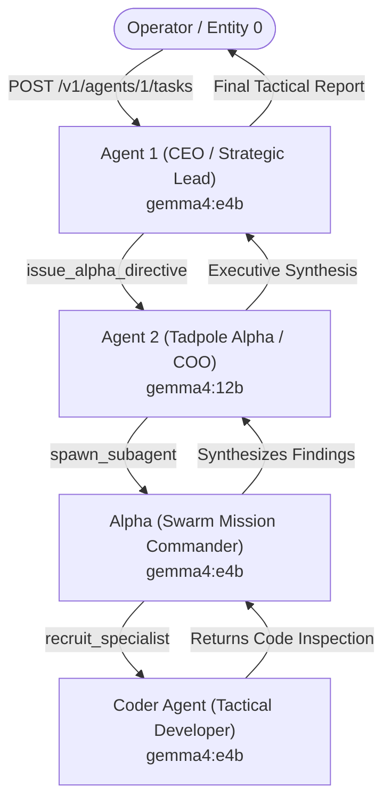

> [!IMPORTANT]
> **AI Context & Knowledge Heritage**
> - **Subsystem**: Architecture & Documentation / Core Docs / tactical_swarm_mission
> - **Architecture**: `@docs ARCHITECTURE:Documentation`
> - **Failure Path**: Information drift, legacy terminology, or documentation mismatch.
> - **Observability**: Traceability via `execution/parity_guard.py` (`[tactical_swarm_mission]`)

# 🐝 The Tactical Swarm: Recursive Multi-Agent Recruitment & Synthesis

This document details the architecture, execution protocol, and verification criteria for **The Tactical Swarm** validation mission. This mission exercises the end-to-end multi-agent hierarchy of AI-Tadpole-OS, validating recursive recruitment, tool access control (ACL), lineage guards, and upward result synthesis.

---

## 1. Swarm Hierarchy & Mission Architecture

The mission exercises a 4-tier Sovereign Command Chain:



### The Mission Directive
> *"Execute a Sovereign Swarm Codebase Inspection. Deconstruct the persistence architecture of Tadpole OS. Inspect how SQLite connection pools and agent transactions are managed in server-rs/src/agent/persistence/agent_db.rs. Recruit the Alpha Commander and Coder specialist to extract key invariants and return a synthesized technical audit report."*

---

## 2. Core Codebase Features Proven Out

### A. Sovereign Access Control (ACL) & Role Tiering
- **Tier 2 Executive (CEO - ID: 1)**: Prohibited from direct file I/O or worker spawning; strictly routes directives via `issue_alpha_directive`.
- **Tier 2 Executive (COO - ID: 2)**: Grounded orchestration node; verifies reality and routes directives to `Alpha`.
- **Tier 1 Mission Commander (Alpha)**: Full authority to recruit tactical specialists (`recruit_specialist` / `spawn_subagent`) and synthesize outputs.
- **Tier 0 Tactical Specialist (Coder)**: Resolves technical tasks independently using inspection tools.

### B. Circular Recruitment & Lineage Safety
- At every tier, `RunContext.lineage` (within `RunContext.mission_state.lineage`) tracks ancestry (`["1", "2", "alpha", "coder"]`).
- If any agent attempts to recruit an ancestor or exceeds `MAX_RECRUITMENT_DEPTH`, the engine blocks recursion with `PROTOCOL_VIOLATION: CIRCULAR_RECRUITMENT`.

### C. Live Swarm Topology & WebSocket Pulses
- During execution, the engine emits `agent:status_changed` and high-frequency msgpack binary pulses over `ws://127.0.0.1:8000/v1/engine/ws`.
- Visualizer nodes and dynamic edges render parent-child connections in real time.

### D. End-to-End Telemetry & Token Aggregation
- Cumulative tokens (`tokens_used` / `tokensUsed`) propagate from each model turn through SQLite (`agents`, `mission_history`) to the REST API (`/v1/agents`).

---

## 3. Automated Execution

Execute the mission and live tailing stream via the deterministic execution script:

```powershell
python execution/run_tactical_swarm_mission.py
```
